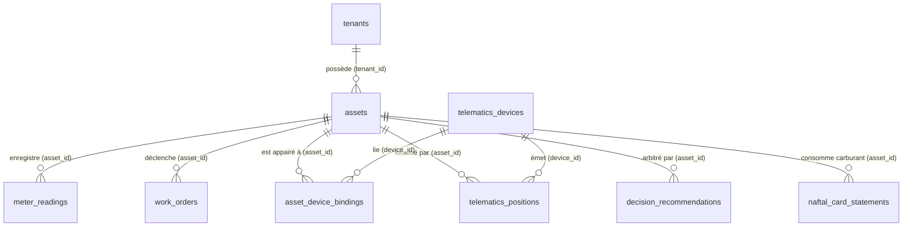
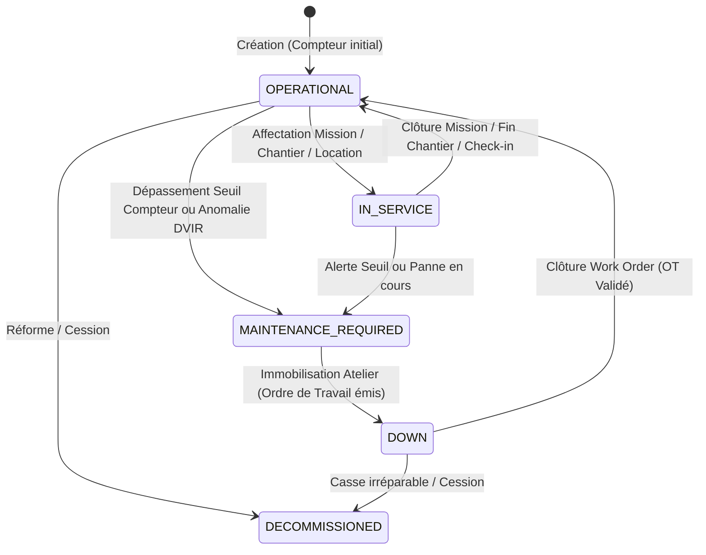
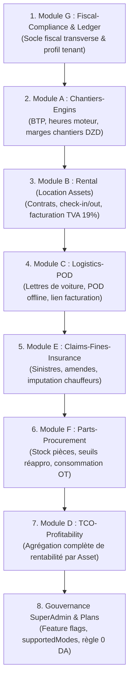

# AUDIT_MODULES.md — Cartographie de l'Actif Racine (Asset) & Audit des 7 Modules ERP Flotte (v2 — Asset-Native)

**Plateforme :** DocteurFlotte 2027 (World-Class Algérie-First & Maintenance 5.0)  
**Date d'audit :** 16 Novembre 2026  
**Auteur :** Lead Architect & Full-Stack Engineer  
**Statut de conformité :** Conforme MASTER_SPEC.md v2.0+ & Règle d'or Asset-Centric

---

## 1. Cartographie Complète de l'Entité Racine Existante (`Asset`)

### 1.1 Définition Fondamentale & Immuabilité
Dans DocteurFlotte, l'entité **`Asset`** est l'unique racine représentative de tout actif physique exploité par l'organisation cliente :
- Poids lourds (tracteurs routiers, camions porteurs, bennes)
- Véhicules utilitaires légers (VUL, fourgons, pick-ups)
- Véhicules de tourisme & liaison
- Engins de travaux publics, mines et carrières (pelles, chargeuses, niveleuses, bulldozers)
- Équipements industriels et groupes électrogènes
- Véhicules frigorifiques (Reefers) et citernes matières dangereuses (HAZMAT)

> [!IMPORTANT]
> **Règle d'or absolue :** Aucune entité concurrente (`Vehicle`, `Engin`, `Equipment`, `Actif`, `Appareil`) ne doit être créée. Tout module métier (Chantiers, Location, Logistique POD, TCO, Sinistres/Amendes, Stock Pièces, Fiscalité) se greffe obligatoirement sur l'Asset existant via une clé étrangère formelle `asset_id UUID NOT NULL REFERENCES assets(id)`.

---

### 1.2 Schéma Physique de la Table `assets` (PostgreSQL)

```sql
-- Extrait canonique apps/api/src/database/database.service.ts
CREATE TABLE IF NOT EXISTS assets (
    id UUID PRIMARY KEY DEFAULT uuid_generate_v4(),
    tenant_id UUID NOT NULL REFERENCES tenants(id) ON DELETE CASCADE,
    name VARCHAR(255) NOT NULL,
    code VARCHAR(100) NOT NULL, -- Immatriculation, code parc interne ou numéro de série
    category VARCHAR(50) NOT NULL, -- ROAD_VEHICLE, HEAVY_TRUCK, CONSTRUCTION_EQUIPMENT, INDUSTRIAL_MACHINE, TECHNICAL_DEVICE, OTHER
    brand VARCHAR(100),
    model VARCHAR(100),
    year INT,
    status VARCHAR(50) NOT NULL DEFAULT 'OPERATIONAL', -- OPERATIONAL, MAINTENANCE_REQUIRED, IN_SERVICE, DOWN, DECOMMISSIONED
    data_origin VARCHAR(50) NOT NULL DEFAULT 'USER_ENTRY', -- DEMO, IMPORT, USER_ENTRY, TELEMATICS, INTEGRATION
    primary_meter_type VARCHAR(50) NOT NULL DEFAULT 'ODOMETER_KM', -- ODOMETER_KM, ENGINE_HOURS, OPERATING_CYCLES, CUSTOM
    current_meter_value NUMERIC(12, 2) NOT NULL DEFAULT 0,
    maintenance_interval_value NUMERIC(12, 2),
    next_maintenance_meter_value NUMERIC(12, 2),
    created_at TIMESTAMPTZ NOT NULL DEFAULT NOW(),
    updated_at TIMESTAMPTZ NOT NULL DEFAULT NOW(),
    
    -- Colonnes ajoutées par les extensions v2.0+ (Migrations 10, Jumeau Numérique & XAI) :
    telemetry_tier df_telemetry_tier NOT NULL DEFAULT 'MODE_0_DECLARATIVE',
    vhi_score NUMERIC(5, 2) DEFAULT 100.0,
    vhi_status VARCHAR(50) DEFAULT 'OPTIMAL',
    bottleneck_component VARCHAR(50) DEFAULT 'cylinderHead',
    physics_state JSONB DEFAULT '{}'::jsonb,
    last_physics_update TIMESTAMPTZ,
    
    CONSTRAINT uq_tenant_asset_code UNIQUE (tenant_id, code)
);
```

---

### 1.3 Relations & Intégrité Référentielle Existantes



- **`meter_readings`** : Relevés métrologiques (kilomètres ou heures moteur) avec détection anti-fraude de recul compteur (`odometerRollbackToleranceKm`).
- **`work_orders`** : Ordres de réparation et interventions atelier rattachés à l'Asset.
- **`asset_device_bindings`** : Historique horodaté d'association entre l'Asset et les boîtiers GPS/IoT (`telematics_devices`).
- **`telematics_positions`** : Trames télématiques issues de Traccar ou Flespi rattachées à l'Asset.
- **`decision_recommendations`** : Arbitrages économiques prédictifs SAD $\rightarrow$ ADS en DZD.
- **`naftal_card_statements`** : Relevés des cartes de paiement Naftal et contrôle topographique Valhalla.

---

### 1.4 Cycle de Vie & Statuts Métier de l'Asset



- **Règle Fiscale & Facturation "Camion au Garage à 0 DA" :**  
  Lorsque l'Asset est au statut `DOWN` ou `MAINTENANCE_REQUIRED`, ou lorsque son kilométrage mensuel en formule dynamique est nul, il est **exclu de la facturation récurrente d'exploitation** conformément au contrat commercial souverain et à la doctrine fiscale DGI.

---

### 1.5 Paliers Télématiques (`telemetry_tier`) & Honnêteté Fonctionnelle

L'Asset porte son niveau d'équipement télématique réel :
1. **`MODE_0_DECLARATIVE` (Zéro Boîtier)** : Déclaratif, factures/reçus Naftal, topographie Valhalla, saisies DVIR PWA mobile hors-ligne.
2. **`MODE_1_GNSS` (GPS Standard)** : Ingestion Traccar, vitesse, contact, géolocalisation, corridors des 58 Wilayas.
3. **`MODE_2_CAN_J1939` (Full Télémétrie)** : Bus CAN, températures réelles (SPN 175), couple moteur (SPN 513), codes défauts DTC, alerte CUSUM siphonnage inattaquable.

La méthode contractuelle `assertTierSupportsFeature(tier, feature, assetCode)` bloque toute opération demandant un palier supérieur à celui de l'Asset, garantissant l'absence de fausses promesses techniques.

---

### 1.6 Points d'Extension Validés pour les 7 Nouveaux Modules

| Type de Point d'Extension | Usage Recommandé | Règles Architecturales |
| :--- | :--- | :--- |
| **Tables d'Extension Dédiées (`asset_*`)** | **Recommandé (95%)** pour l'isolation métier stricte et les performances SQL | Clé étrangère `asset_id UUID NOT NULL REFERENCES assets(id)` avec index `idx_*_asset_id` et RLS sur `tenant_id`. |
| **Champs JSONB Métier (`physics_state`)** | Données volatiles ou calculs intermédiaires | Uniquement pour l'état interne du jumeau numérique ou métadonnées non requêtables en jointure. |
| **Hooks / Déclencheurs Événements** | Synchronisation automatique de statut | Ex: Passer l'Asset en `MAINTENANCE_REQUIRED` lors d'un litige grave ou d'un accident, le passer en `IN_SERVICE` pendant un contrat de location actif. |

---

## 2. Matrice d'Audit des 7 Modules Demandés

| Module Demandé | Statut dans le Codebase | Entités Proposées | Correspondance & Stratégie Asset-Centric |
| :--- | :---: | :--- | :--- |
| **Module A : Chantiers & Engins** (`chantiers-engins`) | **ABSENT** | `Chantier`<br>`AffectationAssetChantier`<br>`ReleveHeuresMoteurAsset`<br>`ChecklistTransfertAsset` | • Créer `site_workspaces` (Chantiers)<br>• Créer `asset_site_assignments` (`asset_id` FK)<br>• Créer `asset_engine_hour_logs` (`asset_id` FK, croise `meter_readings`)<br>• Créer `asset_transfer_checklists` (`asset_id` FK)<br>• Calculer la marge chantier en DZD sur l'Asset existant. |
| **Module B : Location & Rental** (`rental`) | **ABSENT** | `ContratLocation`<br>`ReservationAsset`<br>`CheckInOutLocation`<br>`FactureLocation`<br>`LitigeLocation` | • Créer `asset_rental_contracts` (`asset_id` FK)<br>• Créer `asset_rental_reservations` (`asset_id` FK)<br>• Créer `asset_rental_check_ins_outs` (`asset_id` FK, photos/signatures)<br>• Créer `asset_rental_invoices` (`asset_id` FK, calculs DGI TVA 19%)<br>• Créer `asset_rental_disputes` (`asset_id` FK, scellé SHA-256). |
| **Module C : Logistique & POD** (`logistics-pod`) | **PARTIEL**<br>*(Ordres de mission dans `dispatch`)* | `LettreVoiture`<br>`Expedition`<br>`PreuveLivraison`<br>`RetourLitige`<br>`TableauBordOTIF` | • Étendre le flux mission vers `logistics_consignment_notes` (`asset_id` FK)<br>• Créer `logistics_shipments` (`asset_id` FK)<br>• Créer `logistics_proof_of_delivery` (POD mobile PWA IndexedDB, signature/photo)<br>• Créer `logistics_delivery_disputes` (`asset_id` FK)<br>• Tableau de bord OTIF consolidé. |
| **Module D : TCO & Rentabilité** (`tco-profitability`) | **PARTIEL**<br>*(Vue UI `/tco` mockée)* | `CentreCoutAsset`<br>`CoutDirectMission`<br>`MargeChantier`<br>`SeuilRentabilite`<br>`SimulationDecision` | • Créer `asset_cost_centers` (`asset_id` FK)<br>• Créer `asset_direct_costs` (`asset_id` FK : agrège Naftal, pièces OT, main-d'œuvre, péages, assurances)<br>• Créer `asset_profitability_thresholds` (`asset_id` FK)<br>• Créer simulateur décisionnel "Réparer vs Remplacer" sur 12/24 mois. |
| **Module E : Sinistres, Amendes & Assurances** (`claims-fines-insurance`) | **PARTIEL**<br>*(Polices dans `compliance`)* | `Sinistre`<br>`DossierAssureur`<br>`Amende`<br>`ImputationAmendeChauffeur`<br>`ScoreRisqueAssurance` | • Créer `asset_accident_claims` (`asset_id` FK, photos, constat)<br>• Créer `asset_insurance_cases` (`asset_id` FK, remboursements DZD, franchises)<br>• Créer `asset_traffic_fines` (`asset_id` FK)<br>• Imputation automatique au chauffeur affecté à l'instant t via `asset_device_bindings` / missions<br>• Score de risque d'assurance par Asset et par chauffeur. |
| **Module F : Stock Pièces & Approvisionnement** (`parts-procurement`) | **PARTIEL**<br>*(Coûts pièces bruts dans `work_orders`)* | `PieceStock`<br>`DepotAtelier`<br>`SeuilReappro`<br>`OrdreAchatPiece`<br>`FournisseurPiece`<br>`ConsommationPieceOT` | • Créer `parts_inventory` (Catalogue références OEM)<br>• Créer `parts_warehouses` (Dépôts atelier par Wilaya)<br>• Créer `parts_stock_levels` (Quantités & seuils réappro)<br>• Créer `parts_purchase_orders` (Bons de commande fournisseurs DZD/devises)<br>• Créer `work_order_parts_consumption` (`work_order_id`, `asset_id`, `part_id` FK, décrémentation stock). |
| **Module G : Conformité Fiscale** (`fiscal-compliance`) | **PARTIEL**<br>*(Moteurs mathématiques dans `decision-engine` & barèmes en base)* | `FiscalProfile`<br>`FiscalRuleSet`<br>`FiscalDocument`<br>`FiscalEvent`<br>`DeclarationDraft`<br>`FiscalAuditSeal` | • Créer `tenant_fiscal_profile` (NIF, NIS, RC, AI, régime fiscal, Wilaya)<br>• Créer `fiscal_documents` (`asset_id` FK obligatoire pour tout acte touchant un actif)<br>• Créer `fiscal_events` (`asset_id` FK, qualifié par `packages/decision-engine` TVA/Prorata/TAP/IBS)<br>• Créer `fiscal_declaration_drafts` (G50 / liasse fiscale pré-remplie)<br>• Créer `fiscal_audit_seals` (Scellés SHA-256 inaltérables). |

---

## 3. Plan d'Implémentation & Ordre de Priorité

Pour garantir la stabilité, l'absence de régression et l'interdépendance saine entre les modules, l'exécution s'effectue dans l'ordre suivant :



### Jalons & Dépendances :
1. **Étape 1 : Module G (Fiscal-Compliance)** : Pose les fondations fiscales (profil fiscal, événements fiscaux, scellement SHA-256) en se branchant sur `packages/decision-engine` sans réinventer de règle.
2. **Étape 2 : Module A (Chantiers-Engins)** : Déploie les chantiers et relevés heures moteur sur `Asset`.
3. **Étape 3 : Module B (Rental)** : Gère les contrats de location des Assets et émet des factures rattachées au moteur fiscal.
4. **Étape 4 : Module C (Logistics-POD)** : Complète le flux mission avec lettre de voiture et POD déconnectée.
5. **Étape 5 : Module E (Claims-Fines-Insurance)** : Gère les sinistres et l'imputation automatique des amendes sur l'Asset et le chauffeur actif.
6. **Étape 6 : Module F (Parts-Procurement)** : Stock pièces, dépôts et déduction automatique lors de la clôture des Work Orders de l'Asset.
7. **Étape 7 : Module D (TCO-Profitability)** : Consolide l'ensemble des flux (Chantiers, Rental, POD, Amendes, Carburant Naftal, Pièces Atelier) pour donner la rentabilité exacte par Asset en DZD.
8. **Étape 8 : Gouvernance SuperAdmin & Tests E2E** : Feature flags dans les plans, gestion des quotas et validation de non-duplication d'Asset.

