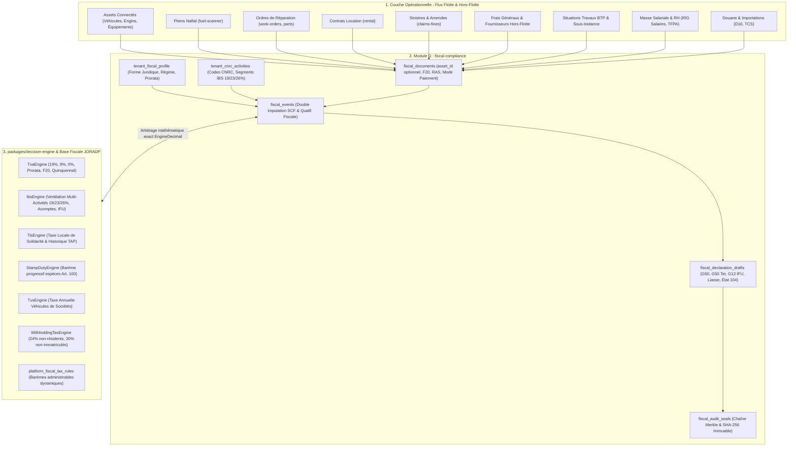

# FISCAL_COMPLIANCE.md — Spécifications du Module Conformité Fiscale Souveraine Multi-Activités & Multi-Régimes (Module G)

**Produit :** DocteurFlotte 2027 (Extension ERP Flotte Asset-Native & Plateforme de Gestion Fiscale Souveraine)  
**Module :** `fiscal-compliance` (Module G)  
**Intégration :** Adossé au moteur fiscal souverain [`packages/decision-engine`](file:///e:/docteurflotte_2027_world_class/packages/decision-engine) & Barèmes JORADP (Lois de Finances LF 2024 à LF 2026)  
**Règle d'or :** Aucun taux, seuil, abattement ou formule fiscale codé en dur — 100 % résolu dynamiquement via le moteur fiscal et la table `platform_fiscal_tax_rules`.

---

## 1. Vision Métier, Périmètre Multi-Activités & Évolutions Réglementaires (LF 2024 - LF 2026)

Le module **Conformité Fiscale (`fiscal-compliance`)** dépasse la simple vision « 100 % gestion de flotte » pour adopter une **architecture souveraine Multi-Activités & Multi-Régimes** couvrant l'intégralité du tissu économique algérien :
- **BTPH & Hydraulique** (engins lourds, chantiers, retenues de garantie, situations de travaux sur encaissement).
- **Industrie & Production** (usines, machines-outils, matières premières classe 3, franchise de TVA F20/F21, amortissements industriels dégressifs).
- **Négoce, Commerce & Distribution** (contrôle facturation Art. 64 CPF, droit de timbre progressif sur espèces, État 104 annuel des clients).
- **Logistique & Transport Routier** (flottes de poids lourds, semi-remorques, carburant gazole Art. 30 TCA 100 % déductible).
- **Location de Véhicules & Auto-Écoles** (dérogation VP Art. 41 TCA & Art. 141-2 CIDTA : déductibilité intégrale et déplafonnement).
- **Professions Libérales & Bureaux d'Études** (médecins, avocats, architectes, experts-comptables : IRG-BNC, TVS annuelle, plafonds VP).
- **Agriculture & Élevage** (tracteurs, intrants agricoles, taux réduit TVA 9 % ou exonération totale, IRG Agricole).
- **Services Pétroliers & Énergie** (canalisations, bases de vie sahariennes, assujettissement à la TLS).
- **Import / Export** (déclarations en douane D10, taxe conjoncturelle TCS, exonération TVA et IBS sur le chiffre d'affaires export en devises).
- **Micro-Entreprises & Auto-Entrepreneurs** (Régime de l'Impôt Forfaitaire Unique IFU G12 / G12 bis à 5 %, 12 % ou 0,5 %).

### 1.1 Corrections et Évolutions Fiscales Intégrées (LF 2024 à LF 2026)

1. **Abrogation de la TAP et Introduction de la TLS (LF 2024 Art. 14) :**
   - La **Taxe sur l'Activité Professionnelle (TAP)** a été définitivement supprimée par l'article 14 de la Loi de Finances 2024 pour l'ensemble des activités de production, BTPH, commerce et services.
   - Elle est remplacée exclusivement pour certains secteurs spécifiques (transport par canalisation d'hydrocarbures) par la **Taxe Locale de Solidarité (TLS)**.
   - Le moteur fiscal gère la traçabilité des exercices fiscaux antérieurs (historique pré-2024) et bascule sur la **TLS** ou 0 DA par défaut pour les exercices 2024+.
2. **Droits de Timbre sur Paiements en Espèces (Barème Progressif LF 2024/2025) :**
   - Conformément à l'Article 100 du Code du Timbre (modifié par LF 2024 et LF 2025), le droit de timbre sur encaissements ou règlements en espèces n'est plus forfaitaire mais suit un **barème progressif par tranches** (1 %, 1,5 %, 2 % selon les seuils légaux de 300 DZD à plus de 1 000 000 DZD).
3. **Gestion Multi-Taux de TVA et Achats en Franchise :**
   - **Taux standard (19 %) :** Prestations de services, commerce général, pièces de rechange, locations.
   - **Taux réduit (9 %) :** Produits alimentaires de large consommation, intrants et matériels agricoles, logement social BTP, services informatiques éligibles.
   - **Taux 0 % :** Exportations de biens et de services (Art. 13 Code des TCA).
   - **Franchise de TVA (Attestations F20 / F21) :** Achats et importations d'équipements et matières premières en franchise pour les projets agréés AAPI (ex-ANDI) et exportateurs.
4. **Dérogation Véhicules de Tourisme — Outil de Travail Principal (Art. 41 TCA & Art. 141-2 CIDTA) :**
   - Si un véhicule de tourisme (`ROAD_VEHICLE`) est l'objet même de l'activité économique de l'entreprise (Agences de location de voitures, auto-écoles, transport public de personnes, taxis en société), la TVA sur l'achat, l'entretien et le carburant est **100 % déductible** et le plafond d'amortissement de 3 000 000 DZD ne s'applique pas (`is_core_business_tool = TRUE` / `fiscal_usage_purpose = 'EXPLOITATION_PRINCIPALE'`).

---

## 2. Architecture Globale & Intégration au Moteur Décisionnel



### Principes Directeurs d'Ingénierie :
1. **Asset-Centric & Extensible Hors-Flotte :** Les flux issus des actifs (`assets.id`) conservent une clé étrangère stricte `asset_id`. Les pièces de frais généraux, sous-traitance BTP, masse salariale ou importations portent un `asset_id` nullable tout en étant ventilées par centre de coût (`cost_center_type`) et code CNRC (`cnrc_activity_id`).
2. **Double Qualification Comptable SCF & Fiscale :** Chaque écriture alimente à la fois les comptes du Système Comptable Financier (Classes 2, 4, 6, 7) et le registre fiscal extracomptable (Tableau 9 de la liasse pour réintégrations et déductions).
3. **Scellement Cryptographique Opposable SHA-256 :** Toute liasse ou déclaration validée génère une empreinte canonique infalsifiable, opposable lors des vérifications approfondies de comptabilité de la DGI.

---

## 3. Schéma Relationnel PostgreSQL Étendu (Multi-Régimes & CNRC)

```sql
-- ============================================================================
-- 1. PROFIL FISCAL ENRICHI (SUPPORT MULTI-RÉGIMES & STATUTS JURIDIQUES)
-- ============================================================================
CREATE TABLE IF NOT EXISTS tenant_fiscal_profile (
    id UUID PRIMARY KEY DEFAULT uuid_generate_v4(),
    tenant_id UUID NOT NULL REFERENCES tenants(id) ON DELETE CASCADE,
    legal_name VARCHAR(255) NOT NULL,
    legal_form VARCHAR(30) NOT NULL DEFAULT 'SARL', -- SPA, SARL, EURL, SNC, EI_BIC, PROF_LIBERALE_BNC, AGRICOLE, AUTO_ENTREPRENEUR
    profit_tax_type VARCHAR(20) NOT NULL DEFAULT 'IBS', -- IBS, IRG_BIC, IRG_BNC, IRG_AGRI, IFU
    nif VARCHAR(32) NOT NULL,
    nis VARCHAR(32),
    rc_number VARCHAR(64),
    article_imposition VARCHAR(32),
    tax_regime VARCHAR(50) NOT NULL DEFAULT 'REEL_NORMAL', -- REEL_NORMAL, REEL_SIMPLIFIE, IFU
    is_vat_subject BOOLEAN NOT NULL DEFAULT TRUE,
    vat_declaration_frequency VARCHAR(20) NOT NULL DEFAULT 'MONTHLY', -- MONTHLY (G50), TRIMESTRIAL
    vat_prorata_pct NUMERIC(5, 2) NOT NULL DEFAULT 100.00, -- Prorata de déduction TVA (Assujettis partiels)
    aapi_exemption_active BOOLEAN NOT NULL DEFAULT FALSE, -- Exonération temporaire AAPI/ANDI/ANADE
    aapi_exemption_end_date DATE,
    wilaya_code INT NOT NULL CHECK (wilaya_code BETWEEN 1 AND 58),
    fiscal_center VARCHAR(150),
    is_configured BOOLEAN NOT NULL DEFAULT FALSE,
    created_at TIMESTAMPTZ NOT NULL DEFAULT NOW(),
    updated_at TIMESTAMPTZ NOT NULL DEFAULT NOW(),
    CONSTRAINT uq_tenant_fiscal_profile UNIQUE (tenant_id)
);

-- ============================================================================
-- 1bis. ACTIVITÉS CNRC DU TENANT (VENTILATION MULTI-ACTIVITÉS ART. 150 CIDTA)
-- ============================================================================
CREATE TABLE IF NOT EXISTS tenant_cnrc_activities (
    id UUID PRIMARY KEY DEFAULT uuid_generate_v4(),
    tenant_id UUID NOT NULL REFERENCES tenants(id) ON DELETE CASCADE,
    cnrc_code VARCHAR(16) NOT NULL, -- Ex: 406101 (Transport), 109201 (BTPH), 101101 (Industrie)
    activity_label VARCHAR(255) NOT NULL,
    fiscal_segment VARCHAR(30) NOT NULL, -- PRODUCTION (19%), BTPH_TOURISME (23%), COMMERCE_SERVICES (26%)
    ifu_segment VARCHAR(30), -- BIENS_PRODUCTION (5%), SERVICES (12%), AUTO_ENTREPRENEUR (0.5%)
    is_subject_to_tls BOOLEAN NOT NULL DEFAULT FALSE, -- Taxe Locale de Solidarité (remplace TAP secteurs ciblés)
    is_primary BOOLEAN NOT NULL DEFAULT FALSE,
    created_at TIMESTAMPTZ NOT NULL DEFAULT NOW(),
    CONSTRAINT uq_tenant_cnrc UNIQUE (tenant_id, cnrc_code)
);

CREATE INDEX IF NOT EXISTS idx_tenant_cnrc_tenant ON tenant_cnrc_activities(tenant_id);

-- ============================================================================
-- 2. PIÈCES JUSTIFICATIVES FISCALES (FLOTTE & HORS-FLOTTE, RAS & FRANCHISE)
-- ============================================================================
CREATE TABLE IF NOT EXISTS fiscal_documents (
    id UUID PRIMARY KEY DEFAULT uuid_generate_v4(),
    tenant_id UUID NOT NULL REFERENCES tenants(id) ON DELETE CASCADE,
    asset_id UUID REFERENCES assets(id) ON DELETE SET NULL, -- Rattaché à l'Asset ou NULL (frais généraux)
    cnrc_activity_id UUID REFERENCES tenant_cnrc_activities(id) ON DELETE SET NULL,
    cost_center_type VARCHAR(40) NOT NULL DEFAULT 'FLEET_ASSET', -- FLEET_ASSET, BTP_CHANTIER, USINE_PRODUCTION, FRAIS_GENERAUX, IMPORT_DOUANE, RH_PAIE
    document_type VARCHAR(50) NOT NULL, -- FACTURE_FOURNISSEUR, FACTURE_CLIENT, TICKET_NAFTAL, ORDRE_TRAVAIL, CONTRAT_LOCATION, AMENDE, CONSTAT_SINISTRE, BULLETIN_PAIE, DECLARATION_D10
    document_number VARCHAR(100) NOT NULL,
    document_date DATE NOT NULL,
    payment_method VARCHAR(30) NOT NULL DEFAULT 'BANK_TRANSFER', -- CASH (déclenche Timbre progressif & contrôle plafond), BANK_TRANSFER, CHECK, CARD_CIB_EDAHABIA
    third_party_name VARCHAR(255),
    third_party_nif VARCHAR(32),
    third_party_nis VARCHAR(32),
    third_party_rc VARCHAR(64),
    article_imposition_third_party VARCHAR(32),
    amount_ht_dzd NUMERIC(14, 2) NOT NULL DEFAULT 0,
    vat_rate_pct NUMERIC(5, 2) NOT NULL DEFAULT 0, -- 19.00, 9.00, 0.00
    vat_amount_dzd NUMERIC(14, 2) NOT NULL DEFAULT 0,
    stamp_duty_dzd NUMERIC(10, 2) NOT NULL DEFAULT 0, -- Droit de timbre calculé selon barème progressif
    total_ttc_dzd NUMERIC(14, 2) NOT NULL DEFAULT 0,
    is_vat_exempt_f20 BOOLEAN NOT NULL DEFAULT FALSE, -- Achat en franchise de TVA (Attestation F20/F21)
    f20_certificate_number VARCHAR(64),
    is_vat_deductible BOOLEAN NOT NULL DEFAULT TRUE,
    deductibility_rationale VARCHAR(255),
    withholding_tax_rate_pct NUMERIC(5, 2) NOT NULL DEFAULT 0, -- RAS (24% étranger, 30% non-immatriculé)
    withholding_tax_amount_dzd NUMERIC(14, 2) NOT NULL DEFAULT 0,
    verification_status VARCHAR(50) NOT NULL DEFAULT 'PENDING_AUDIT', -- VALIDATED, REJECTED, SUSPICIOUS, PENDING_AUDIT
    rejection_reason TEXT,
    sha256_fingerprint VARCHAR(64) NOT NULL,
    created_at TIMESTAMPTZ NOT NULL DEFAULT NOW()
);

CREATE INDEX IF NOT EXISTS idx_fiscal_docs_tenant_asset ON fiscal_documents(tenant_id, asset_id);
CREATE INDEX IF NOT EXISTS idx_fiscal_docs_date ON fiscal_documents(tenant_id, document_date);
CREATE INDEX IF NOT EXISTS idx_fiscal_docs_cost_center ON fiscal_documents(tenant_id, cost_center_type);

-- ============================================================================
-- 3. ÉVÉNEMENTS FISCAUX QUALIFIÉS (DOUBLE IMPUTATION SCF & IMPÔT)
-- ============================================================================
CREATE TABLE IF NOT EXISTS fiscal_events (
    id UUID PRIMARY KEY DEFAULT uuid_generate_v4(),
    tenant_id UUID NOT NULL REFERENCES tenants(id) ON DELETE CASCADE,
    asset_id UUID REFERENCES assets(id) ON DELETE SET NULL,
    document_id UUID REFERENCES fiscal_documents(id) ON DELETE CASCADE,
    cnrc_activity_id UUID REFERENCES tenant_cnrc_activities(id) ON DELETE SET NULL,
    event_type VARCHAR(100) NOT NULL, -- TVA_DEDUCTION, TVA_COLLECTED, NON_DEDUCTIBLE_PENALTY, QUINQUENNIAL_ADJUSTMENT, ASSET_DEPRECIATION, IBS_TAX_REINTEGRATION, RAS_WITHHOLDING
    tax_category VARCHAR(50) NOT NULL, -- TVA, TLS, TAP, IBS, IRG, TIMBRE, TVS, TFPA, RAS
    taxable_base_dzd NUMERIC(14, 2) NOT NULL,
    applied_rate_pct NUMERIC(5, 2) NOT NULL,
    tax_amount_dzd NUMERIC(14, 2) NOT NULL,
    accounting_account VARCHAR(50) NOT NULL, -- Ex: 445600 (TVA déductible), 658000 (Pénalités), 442000 (RAS)
    period_year INT NOT NULL,
    period_month INT NOT NULL,
    metadata JSONB NOT NULL DEFAULT '{}'::jsonb,
    created_at TIMESTAMPTZ NOT NULL DEFAULT NOW()
);

CREATE INDEX IF NOT EXISTS idx_fiscal_events_lookup ON fiscal_events(tenant_id, period_year, period_month);
CREATE INDEX IF NOT EXISTS idx_fiscal_events_asset ON fiscal_events(tenant_id, asset_id);
CREATE INDEX IF NOT EXISTS idx_fiscal_events_category ON fiscal_events(tenant_id, tax_category);

-- ============================================================================
-- 4. BROUILLONS DE DÉCLARATIONS PÉRIODIQUES (G50, G50 TER, G12 IFU, LIASSE SCF)
-- ============================================================================
CREATE TABLE IF NOT EXISTS fiscal_declaration_drafts (
    id UUID PRIMARY KEY DEFAULT uuid_generate_v4(),
    tenant_id UUID NOT NULL REFERENCES tenants(id) ON DELETE CASCADE,
    period_year INT NOT NULL,
    period_month INT NOT NULL,
    declaration_type VARCHAR(50) NOT NULL DEFAULT 'G50_MONTHLY', -- G50_MONTHLY, G50_TRIMESTRIAL, G50_TER, G12_PROVISIONAL, G12_BIS_DEFINITIVE, G4_LIASSE_SCF, ETAT_104_CLIENTS
    total_taxable_revenue_dzd NUMERIC(16, 2) NOT NULL DEFAULT 0,
    total_vat_collected_dzd NUMERIC(16, 2) NOT NULL DEFAULT 0,
    total_vat_deductible_dzd NUMERIC(16, 2) NOT NULL DEFAULT 0,
    net_vat_payable_dzd NUMERIC(16, 2) NOT NULL DEFAULT 0,
    tls_amount_dzd NUMERIC(16, 2) NOT NULL DEFAULT 0, -- Taxe Locale de Solidarité (remplace TAP LF 2024+)
    ibs_installment_dzd NUMERIC(16, 2) NOT NULL DEFAULT 0, -- Acomptes provisionnels IBS (20 mars, 20 juin, 20 nov)
    irg_salaries_withheld_dzd NUMERIC(16, 2) NOT NULL DEFAULT 0, -- IRG Salaires retenu à la source
    other_withholding_taxes_dzd NUMERIC(16, 2) NOT NULL DEFAULT 0, -- RAS tiers / non-résidents
    tvs_amount_dzd NUMERIC(14, 2) NOT NULL DEFAULT 0, -- Taxe sur les Véhicules de Sociétés
    stamp_duty_total_dzd NUMERIC(14, 2) NOT NULL DEFAULT 0,
    total_due_dzd NUMERIC(16, 2) NOT NULL DEFAULT 0,
    status VARCHAR(50) NOT NULL DEFAULT 'DRAFT', -- DRAFT, VALIDATED, SEALED, EXPORTED
    breakdown_by_activity JSONB NOT NULL DEFAULT '{}'::jsonb, -- Ventilation CA & impôt par segment (19%, 23%, 26%)
    breakdown_by_asset JSONB NOT NULL DEFAULT '{}'::jsonb,
    missing_receipts_count INT NOT NULL DEFAULT 0,
    created_at TIMESTAMPTZ NOT NULL DEFAULT NOW(),
    updated_at TIMESTAMPTZ NOT NULL DEFAULT NOW()
);

CREATE INDEX IF NOT EXISTS idx_fiscal_drafts_period ON fiscal_declaration_drafts(tenant_id, period_year, period_month);

-- ============================================================================
-- 5. SCELLÉS CRYPTOGRAPHIQUES & JOURNAL D'AUDIT IMMUABLE SHA-256
-- ============================================================================
CREATE TABLE IF NOT EXISTS fiscal_audit_seals (
    id UUID PRIMARY KEY DEFAULT uuid_generate_v4(),
    tenant_id UUID NOT NULL REFERENCES tenants(id) ON DELETE CASCADE,
    declaration_id UUID NOT NULL REFERENCES fiscal_declaration_drafts(id) ON DELETE CASCADE,
    sealed_by_user_id VARCHAR(100) NOT NULL,
    sealed_at TIMESTAMPTZ NOT NULL DEFAULT NOW(),
    canonical_payload TEXT NOT NULL,
    sha256_hash VARCHAR(64) NOT NULL,
    merkle_leaf VARCHAR(64) NOT NULL
);
```

---

## 4. Endpoints API REST du Module

| Méthode | Route | Rôle Requis | Description |
| :--- | :--- | :--- | :--- |
| `GET` | `/api/v1/fiscal/profile` | `Admin`, `DAF`, `SuperAdmin` | Obtient le profil fiscal enrichi du tenant (statut juridique, régime, prorata, exonérations). |
| `PUT` | `/api/v1/fiscal/profile` | `Admin`, `DAF` | Met à jour le profil fiscal (NIF, NIS, régime, prorata TVA, exonération AAPI). |
| `GET` | `/api/v1/fiscal/cnrc-activities` | `Admin`, `DAF` | Liste les activités CNRC enregistrées avec leur segmentation fiscale (19%, 23%, 26%, IFU). |
| `POST` | `/api/v1/fiscal/cnrc-activities` | `Admin`, `DAF` | Déclare ou met à jour une activité CNRC pour ventilation du chiffre d'affaires. |
| `GET` | `/api/v1/fiscal/events` | `Admin`, `DAF`, `Exploitant` | Liste les événements fiscaux filtrés par période, par `assetId` ou par code CNRC. |
| `POST` | `/api/v1/fiscal/events/recompute` | `Admin`, `DAF` | Recalcule l'ensemble des qualifications fiscales et réintégrations suite à modification. |
| `GET` | `/api/v1/fiscal/declarations/drafts` | `Admin`, `DAF` | Liste les déclarations (G50, G50 Ter, G12 IFU, Liasse SCF, État 104). |
| `POST` | `/api/v1/fiscal/declarations/drafts` | `Admin`, `DAF` | Génère un nouveau brouillon déclaratif pré-rempli avec ventilation multi-activités. |
| `POST` | `/api/v1/fiscal/declarations/:id/seal` | `Admin`, `DAF` | Scelle définitivement une liasse ou déclaration avec empreinte SHA-256 opposable. |
| `GET` | `/api/v1/fiscal/declarations/:id/export` | `Admin`, `DAF` | Exporte la déclaration au format DGI Jibayatic (XML/CSV standardisé) ou PDF officiel. |
| `GET` | `/api/v1/fiscal/audit` | `Admin`, `DAF`, `SuperAdmin` | Journal d'audit et vérification formelle de l'arbre de Merkle et des scellés. |
| `GET` | `/api/v1/fiscal/asset-summary/:assetId` | `Admin`, `DAF`, `Chef d'Atelier` | Synthèse fiscale détaillée de l'Asset (TVA déduite, charges déductibles vs réintégrées, TVS). |

---

## 5. Règles de Contrôle, Détection des Anomalies & Conformité DGI

1. **Contrôle d'Existence et Intégrité de l'Asset :** Toute pièce rattachée à un actif doit cibler un `asset_id` valide et non décommissionné. Les pièces hors-flotte (frais généraux, BTP, salaires) doivent obligatoirement porter un `cost_center_type` et un code `cnrc_activity_id`.
2. **Détection des Doublons Fiscaux :** Rejet immédiat si un document présente le même `third_party_nif`, `document_number` et montant dans l'exercice fiscal.
3. **Qualification TVA Carburant & Dérogation Véhicules de Tourisme (VP) :**
   - *Règle générale (Art. 30 Code TCA) :* Les véhicules de tourisme (`ROAD_VEHICLE`) n'ouvrent pas droit à déduction de la TVA sur le carburant, les pièces et les réparations. Les poids lourds, tracteurs et utilitaires (`HEAVY_TRUCK`, `CONSTRUCTION_BTP`, `LIGHT_COMMERCIAL`) bénéficient d'une déductibilité à 100 %.
   - *Dérogation VP Outil de Travail (Art. 41 TCA & Art. 141-2 CIDTA) :* Si l'actif est un véhicule de tourisme affecté à une activité de **Location (Rent-a-car)**, **Auto-École** ou **Transport Public de Personnes** (`is_core_business_tool = TRUE` ou `fiscal_usage_purpose = 'EXPLOITATION_PRINCIPALE'`), la TVA est **100 % déductible** et le plafonnement d'amortissement ne s'applique pas.
4. **Blocage si Pièce Manquante ou Suspecte :** Une déclaration ne peut être scellée (`SEALED`) si des documents comportent le statut `SUSPICIOUS` ou des factures au-delà des seuils sans scan/justificatif légal.
5. **Plafond Légal de Paiement en Espèces (Déductibilité des Charges & TVA) :**
   - Conformément aux dispositions des Lois de Finances récentes modifiant le CIDTA et le Code des TCA, toute facture fournisseur réglée en espèces (`payment_method = 'CASH'`) au-delà du seuil légal autorisé (**1 000 000 DZD TTC**) perd automatiquement le droit à la déduction de la TVA et sa charge devient non déductible de l'assiette de l'IBS/IRG.
   - Le moteur émet une alerte bloquante `CASH_THRESHOLD_EXCEEDED` et isole la charge pour réintégration fiscale.
6. **Conformité des Mentions Légales Obligatoires du Tiers (Art. 64 CPF) :**
   - Une facture fournisseur au régime réel ne peut ouvrir droit à déduction de TVA que si les mentions `third_party_nif` (15 ou 20 chiffres), `third_party_rc` et `article_imposition` sont renseignées et syntaxiquement conformes aux nomenclatures de la DGI.
7. **Fait Générateur de la TVA Hybride (Débit vs Encaissement) :**
   - Le moteur distingue automatiquement les flux où le fait générateur est la facturation/livraison du bien (Vente de marchandises, négoce, livraison d'actifs) de ceux où la TVA n'est exigible qu'à **l'encaissement effectif** (travaux immobiliers BTP, prestations de services, locations).
8. **Réintégration Fiscale Automatique au Tableau 9 (Liasse Fiscale SCF) :**
   - Toute charge enregistrée sur un actif de tourisme non dérogatoire au-delà du plafond d'amortissement fiscal de 3 000 000 DZD, ou toute pénalité/amende routière (Art. 169 CIDTA), génère simultanément une écriture comptable normale (classe 6) ET un événement `IBS_TAX_REINTEGRATION` alimentant automatiquement le Tableau 9 de passage du résultat comptable au résultat fiscal.

---

## 6. Matrice d'Adaptation Sectorielle (Couverture 100 % des Activités Algériennes)

Le module `fiscal-compliance` ajuste dynamiquement ses règles de qualification selon les codes CNRC (`tenant_cnrc_activities`) et l'affectation analytique de l'actif ou de la dépense :

| Secteur d'Activité | Régime / Taux IBS | Spécificités Fiscales Gérées par le Moteur (`decision-engine`) |
| :--- | :--- | :--- |
| **Transport & Logistique** | IBS 26 % (Services) ou IFU 12 % | TVA 100 % déductible sur camions, tracteurs routiers, remorques, gazole et pneumatiques. |
| **Location de Véhicules & Auto-Écoles** | IBS 26 % ou IFU 12 % | **Dérogation VP (Art. 41 TCA & 141-2 CIDTA) :** Déductibilité à 100 % de la TVA et déplafonnement de l'amortissement sur les véhicules de tourisme affectés à l'exploitation directe (`is_core_business_tool = TRUE`). |
| **BTPH & Hydraulique** | IBS 23 % | Fait générateur de la TVA à **l'encaissement** (situations de travaux). Gestion des engins de chantier (pelles, grues, centrales à béton) et retenues de garantie. |
| **Industrie & Production** | IBS 19 % | Gestion des achats en franchise de TVA (Attestations F20/F21), amortissements industriels dégressifs ou progressifs, suivi des matières premières (Classe 3 SCF). |
| **Commerce & Distribution** | IBS 26 % ou IFU 5 % | Contrôle strict de la facturation conforme (Art. 64 CPF), gestion du droit de timbre progressif sur encaissements espèces, génération de l'**État 104** (état annuel des clients). |
| **Professions Libérales & Bureaux d'Études** | IRG-BNC ou IFU 12 % | Fait générateur sur encaissement, suivi des plafonds d'amortissement VP (3 000 000 DZD) et TVS annuelle. |
| **Import / Export** | IBS selon secteur (Exonération Export) | Intégration des déclarations douanières **D10**, valeur en douane, droits de douane, TCS (Taxe Conjoncturelle), et exonération TVA/IBS sur le CA réalisé en devises à l'export. |
| **Agriculture & Élevage** | IRG Agricole / Exonérations | Taux réduit TVA (9 %) ou exonération sur intrants et équipements agricoles spécifiques, exonérations permanentes ou temporaires d'IRG/IBS. |

---

## 7. Calendrier et Livrables Déclaratifs Supportés (`declaration_type`)

Outre la **G50 mensuelle**, le moteur génère et scelle l'ensemble des déclarations exigées par la DGI (Direction Générale des Impôts) et télé-déclarables sur le portail **Jibayatic** :

1. **`G50_MONTHLY` / `G50_TRIMESTRIAL` :**  
   TVA (19 % / 9 %), Droit de timbre progressif sur espèces (Art. 100 Code du Timbre), IRG/Salaires, Acomptes provisionnels IBS (20 mars, 20 juin, 20 novembre), Retenues à la source (RAS : 24 % non-résidents, 30 % non-immatriculés), Taxe Locale de Solidarité (TLS pour secteurs éligibles).
2. **`G50_TER` :**  
   Déclaration trimestrielle dédiée exclusivement au versement de l'IRG/Salaires pour les contribuables relevant du régime de l'IFU employant du personnel salarié.
3. **`G12_PROVISIONAL` & `G12_BIS_DEFINITIVE` :**  
   Déclarations prévisionnelle (avant le 30 juin de chaque année) et définitive (avant le 20 janvier N+1) pour les contribuables soumis à l'**Impôt Forfaitaire Unique (IFU)** (5 % biens/production, 12 % prestations) et les **Auto-Entrepreneurs** (0,5 %).
4. **`G4_LIASSE_FISCALE_IBS` / `G11_IRG_BIC` :**  
   Bilan fiscal annuel selon le Système Comptable Financier (**SCF**), intégrant le **Tableau 9** de passage du résultat comptable au résultat fiscal : réintégrations automatiques des amendes routières (Art. 169 CIDTA), amortissements excédentaires VP > 3 000 000 DZD (hors dérogation), dons ou frais somptuaires hors plafonds, et déductions extracomptables.
5. **`ETAT_104_CLIENTS` & `ETAT_FOURNISSEURS` :**  
   Export structuré (XML/CSV/Excel compatible portail Jibayatic) récapitulant le chiffre d'affaires annuel par client et fournisseur avec validation préalable de la structure des **NIF (15 ou 20 chiffres)**, **NIS**, **RC** et **Article d'Imposition**.
6. **`DECLARATION_TFPA` & `TVS` :**  
   Calcul annuel automatisé de la Taxe de Formation Professionnelle et d'Apprentissage (TFPA 1 % + 1 % de la masse salariale) et de la Taxe sur les Véhicules de Sociétés (TVS selon puissance fiscale et cylindrée).
