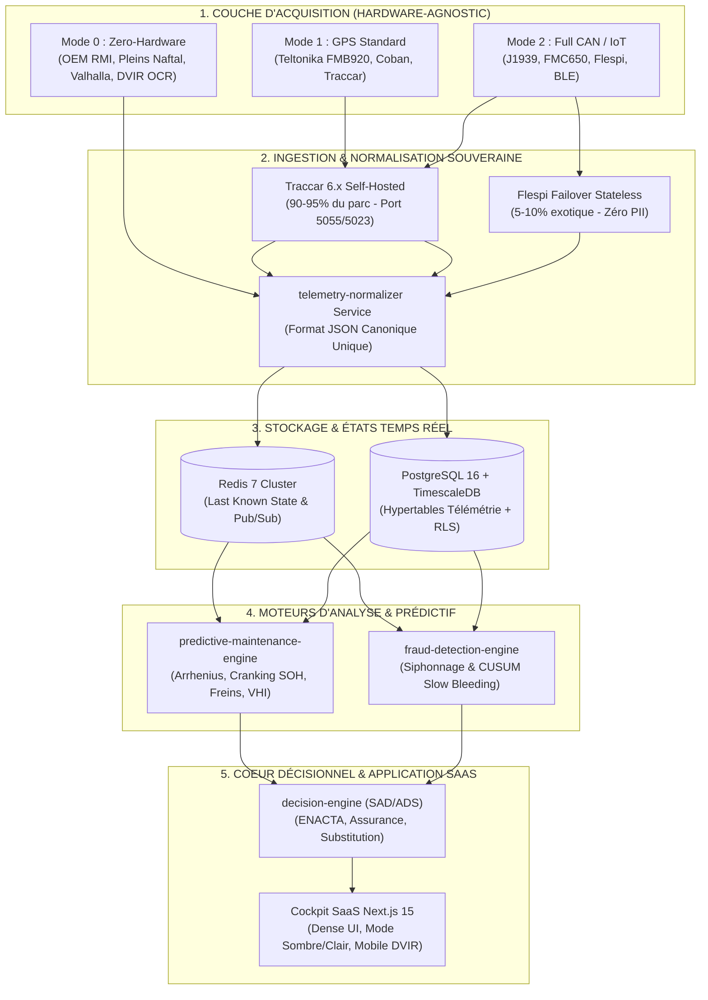

# DOCUMENT DE RÉFÉRENCE ARCHITECTURAL & BUSINESS (MASTER SPEC v2.0)
## Plateforme Souveraine de Télémétrie, IoT Multi-Métiers, Maintenance Prédictive (OEM-First) & Aide à la Décision Réglementaire — Marché Algérien

**Version :** 2.0 (Texte Intégral Non Compressé)  
**Date :** 2026-10-24  
**Cible :** Google Antigravity IDE / Agents de Développement / Partenaires Stratégiques  
**Dépôt de référence :** Monorepo TypeScript & Python (NestJS / FastAPI, Next.js 15, PostgreSQL 16 / TimescaleDB, Traccar 6.x / Flespi)

---

## Sommaire Exécutif

1. [Vision Business, Modèle d'Adoption « OEM-First » & Souveraineté Algérie](#1-vision-business-modèle-dadoption--oem-first---souveraineté-algérie)
2. [Architecture Technique Hybride (Traccar Primaire + Flespi Failover) & Dépôts GitHub](#2-architecture-technique-hybride-traccar-primaire--flespi-failover--dépôts-github)
3. [Base de Données Constructeurs (OEM RMI) & Modèle « Zéro Boîtier »](#3-base-de-données-constructeurs-oem-rmi--modèle--zéro-boîtier-)
4. [Spécifications Mathématiques & Code Complet des 6 Algorithmes Prédictifs](#4-spécifications-mathématiques--code-complet-des-6-algorithmes-prédictifs)
5. [Moteur Décisionnel Réglementaire & Opérationnel (SAD $\rightarrow$ ADS Algérie)](#5-moteur-décisionnel-réglementaire--opérationnel-sad--ads-algérie)
6. [Visualisation Interactive & Architecture 5 Couches](#6-visualisation-interactive--architecture-5-couches)
7. [Exploitation sous Antigravity IDE & Script de Génération Word (.docx)](#7-exploitation-sous-antigravity-ide--script-de-génération-word-docx)

---

## 1. VISION BUSINESS, MODÈLE D'ADOPTION « OEM-FIRST » & SOUVERAINETÉ ALGÉRIE

### 1.1 Le Problème du Marché Algérien & Notre Avantage Concurrentiel

Sur le marché algérien (Logistique, Transport routier de marchandises, BTP & Mines, Agriculture, Agroalimentaire et Distribution), les gestionnaires de flottes font face à quatre obstacles majeurs :

1. **Hétérogénéité du parc et absence initiale de boîtiers :** De nombreuses entreprises possèdent des véhicules dépourvus de tout boîtier télématique, ou équipés de simples traceurs GPS d'ancienne génération sans lecture CAN bus. Conditionner l'utilisation et la facturation du SaaS à l'installation préalable de boîtiers bloque immédiatement le cycle de vente et allonge le Time-To-Value (TTFV) de plusieurs mois.
2. **Coût de la panne imprévue et rareté des pièces de rechange d'origine :** L'immobilisation imprévue d'un tracteur routier (Renault Trucks, MAN, Mercedes-Benz, Shacman, Sinotruk) ou d'un engin BTP sur des axes vitaux (tels que la Transsaharienne, l'axe Alger–Hassi Messaoud ou la pénétrante de Béjaïa) génère des coûts de remorquage prohibitifs, des pénalités de retard client et des pertes sèches d'exploitation.
3. **Coulées de carburant et fraudes (Siphonnage brusque et piquage lent « Slow Bleeding ») :** L'écart récurrent entre les tickets de carburant déclarés (réseau Naftal / cartes prépayées) et la consommation mécanique réelle des injecteurs pèse lourdement sur la marge opérationnelle brute.
4. **Risque réglementaire et pénalités de mise en fourrière :** Un véhicule circulant avec un contrôle technique ENACTA expiré, une police d'assurance RC/CatNat caduque ou en infraction avec les arrêtés wilayaux de restriction de tonnage et d'horaires s'expose à l'immobilisation immédiate par les forces de l'ordre, avec perte du chargement.

---

### 1.2 Architecture « OEM-First & Hardware-Agnostic » (3 Modes d'Exploitation)

Pour vendre et déployer le SaaS **dès le premier jour (J+1)** sans attendre l'installation matérielle sur 100 % de la flotte, la plateforme opère selon 3 modes progressifs qui alimentent le même moteur décisionnel et économique :

| Mode d'Exploitation | Source des Données d'Entrée | Fonctionnement du Moteur de Maintenance & Décision | Cible Commerciale Algérie |
| :--- | :--- | :--- | :--- |
| **Mode 0 : Sans Boîtier (Zero-Hardware / OEM-First)** | - Décodage VIN + Base Constructeur (OEM RMI)<br>- Saisie odomètre mobile chauffeur (DVIR avec OCR)<br>- Import tickets / cartes carburant (Naftal)<br>- Ordres de réparation ateliers | **Estimation Cinématique par Carburant & Missions :** Le système déduit les kilomètres parcourus et les heures moteur via les volumes de carburant consommés et les feuilles de route, puis applique les intervalles constructeurs ajustés au climat algérien (Normal vs Sévère). | Flottes en phase d'onboarding, sous-traitants, transporteurs tiers, vieux camions non équipés, ateliers mécaniques. |
| **Mode 1 : GPS Standard (3-Fils : +, -, Contact)** | - Traceurs GPS existants via Traccar<br>- `gpsOdometerMeters` (Odomètre virtuel)<br>- Tension batterie (`power` / `batteryVoltage`)<br>- Contact virtuel ou filaire (`ignition`) | **Suivi Kilométrique & Heures Moteur Virtuelles :** Calcul précis du temps de marche moteur (entre `ignition ON` et `OFF`), détection de chute de tension au démarrage (santé batterie), usure des freins par décélération GPS combinée au relief topographique. | Flottes déjà équipées de traceurs basiques (Teltonika FMB920, Coban, Queclink, Ruptela) souhaitant migrer sans changer de matériel. |
| **Mode 2 : Full Télémétrie (CAN / J1939 / OBD-II / IoT)** | - Boîtiers CAN/J1939 (Teltonika FMC650, FMB140, ESP32/TWAI custom) via Traccar ou Flespi<br>- `obdOdometerMeters`, `obdEngineSeconds`<br>- Sondes carburant capacitives, sondes BLE, PTO | **Maintenance Prédictive Temps Réel (RUL & VHI) :** Lecture directe des calculateurs (ECU), codes défauts (DTC / SPN-FMI), dégradation thermique de l'huile moteur (Arrhenius), colmatage FAP, et détection de piquage lent du carburant au millilitre près. | Poids lourds longue distance, flottes BTP & engins de carrière, transport frigorifique sous chaîne du froid, machinisme agricole (ISOBUS). |

---

### 1.3 Verticalisation Multi-Métiers

Le modèle de données utilise un système de **Profils Métiers Polymorphes (`primary_industry`)** qui adapte automatiquement les interfaces, les règles d'alerte et les calculs sans duplication de code :

- **Transport Routier & Logistique :** Suivi odométrique rigoureux, contrôle de la chaîne du froid (sondes BLE température 1 à 4), réconciliation carburant Naftal vs débitmètre CAN, respect strict des contrôles ENACTA et des restrictions horaires wilayales pour poids lourds.
- **BTP, Carrières, Mines & Génie Civil :** Maintenance pilotée par les heures de fonctionnement moteur (`engine_hours`) et d'activation de la prise de force (`pto_engaged` / `auxInput`) pour grues, malaxeurs à béton et pelles hydrauliques ; détection de franchissement de zone de chantier autorisée (*Geofence Breach*).
- **Agriculture & Agro-industrie :** Suivi horaire des tracteurs et moissonneuses-batteuses, application d'un coefficient d'encrassement sévère sur la filtration air/gazole (poussière et silice), identification des outils attelés via balises Bluetooth BLE (*Asset Tags*) ou bus ISOBUS J1939.
- **Ateliers & Réseau de Maintenance Centralisé :** Portail dédié aux chefs d'atelier et techniciens pour la prise en charge des Ordres de Travail (OT) générés par le moteur décisionnel, gestion des pièces d'usure et certification numérique des interventions.

---

### 1.4 Stratégie d'Hébergement Self-Hosted & Conformité Loi 18-07 (ANPDP)

- **Souveraineté Nationale Absolue :** L'intégralité de la chaîne opérationnelle (Application Web, API NestJS/FastAPI, base PostgreSQL 16 avec TimescaleDB et PostGIS, Redis 7, serveur Traccar et passerelles OSRM/Valhalla) est conteneurisée sous Docker Compose / Kubernetes (K3s) et hébergée localement en Algérie (Data Centers souverains type Issal, Algérie Télécom, Ticos ou serveurs d'entreprise sur site).
- **Cloisonnement Strict de Flespi (Tiers de Secours Éventuel) :** Flespi n'est sollicité qu'en tant que décodeur de trames sans état (*stateless*). Seul l'identifiant matériel (`device_imei`) transite par ce flux ; **aucune donnée nominative** (nom du conducteur, client, feuille de route, plaque d'immatriculation, raison sociale du tenant) ne quitte le territoire national, assurant une conformité rigoureuse avec la **Loi algérienne n° 18-07** relative à la protection des personnes physiques dans le traitement des données à caractère personnel (ANPDP).

---

## 2. ARCHITECTURE TECHNIQUE HYBRIDE (TRACCAR PRIMAIRE + FLESPI FAILOVER) & DÉPÔTS GITHUB

### 2.1 Écosystème Open-Source (Dépôts GitHub Gratuits à Intégrer)

Pour accélérer le déploiement sous Antigravity IDE tout en garantissant un coût d'infrastructure maîtrisé :

| Brique Technique | Dépôt GitHub / Source Officielle | Licence | Rôle Exact dans notre Architecture SaaS |
| :--- | :--- | :---: | :--- |
| **Serveur d'Ingestion Primaire** | [traccar/traccar](https://github.com/traccar/traccar) | Apache 2.0 | Réception TCP/UDP directe de plus de 200 protocoles télématiques (Teltonika Codec 8/8E/16, Queclink, Ruptela, OsmAnd). |
| **Bases de Décodage CAN Bus** | [commaai/opendbc](https://github.com/commaai/opendbc) | MIT | Collection ouverte de fichiers `.dbc` constructeurs pour décoder les trames brutes en métriques physiques exploitables. |
| **Moteur de Parsing CAN & J1939** | [cantools/cantools](https://github.com/cantools/cantools) | MIT | Librairie de référence pour parser les trames CAN/J1939 transmises sous forme d'attributs bruts hexadécimaux. |
| **Décodage Poids Lourds J1939** | [ebroecker/canmatrix](https://github.com/ebroecker/canmatrix) | BSD | Conversion et manipulation de matrices de signaux CAN et extraction normalisée des PGN / SPN / FMI (norme SAE J1939). |
| **Base Séries Temporelles** | [timescale/timescaledb](https://github.com/timescale/timescaledb) | Apache 2.0 | Extension PostgreSQL transformant la table `telemetry_events` en Hypertable partitionnée avec compression native > 90 %. |
| **Routage Poids Lourds & Relief** | [valhalla/valhalla](https://github.com/valhalla/valhalla) | MIT | Moteur de calcul d'itinéraires self-hosted avec données OSM Algérie intégrant gabarits camions (hauteur, tonnage) et profil d'altitude. |
| **Map Matching Haute Performance** | [Project-OSRM/osrm-backend](https://github.com/Project-OSRM/osrm-backend) | BSD 2-Clause | Recalage géométrique précis des traces GPS bruitées sur le réseau routier algérien (*Match service*) et calcul matriciel. |
| **Orchestrateur de Processus** | [temporalio/temporal](https://github.com/temporalio/temporal) | MIT | Exécution déterministe et résiliente des workflows longs (rappels ENACTA, escalade d'arbitrages, clôture d'ordres de travail). |
| **Passerelle Flespi (Secours)** | [flespi-software](https://github.com/flespi-software) | MIT | Connecteurs MQTT / HTTP REST pour le flux de secours lors de l'intégration de boîtiers aux protocoles propriétaires fermés. |

---

### 2.2 Logique d'Ingestion Hybride : Traccar en Premier, Flespi en Second Rideau

L'objectif architectural est de traiter **90 à 95 % du parc via Traccar auto-hébergé** (coût de licence nul, souveraineté complète) et de réserver Flespi uniquement aux équipements présentant des protocoles exotiques non documentés :

```text
       Traceurs GPS / Boîtiers CAN (Teltonika, Queclink, Coban, ESP32)
                                    │
           ┌────────────────────────┴────────────────────────┐
           ▼ (90-95% du trafic)                              ▼ (5-10% failover/exotique)
    Traccar 6.x Self-Hosted                           Flespi MQTT Gateway
    (Port TCP/UDP 5055, 5023...)                      (Protocole propriétaire)
           │                                                 │
           │ (Webhook HTTP JSON)                             │ (Stream MQTT / HTTP)
           └────────────────────────┬────────────────────────┘
                                    ▼
                       telemetry-normalizer Service
                       (Mapping Canonique Unique)
                                    │
           ┌────────────────────────┴────────────────────────┐
           ▼                                                 ▼
      Redis 7 Cluster                                 TimescaleDB 16
  (Last Known State & Pub/Sub)                    (Hypertables Partitionnées)
```

---

### 2.3 Table de Mapping Canonique (Traccar $\leftrightarrow$ Flespi $\leftrightarrow$ Standard SaaS)

Toutes les sources de données (Traccar, Flespi ou Mode 0 virtuel) sont traduites vers ce format canonique unique avant persistance :

| Clé Canonique SaaS | Type SQL & Unité | Clé Traccar (`attributes`) | Clé Flespi Standard | Rôle Métier & Algorithme Associé |
| :--- | :--- | :--- | :--- | :--- |
| `timestamp_utc` | TIMESTAMPTZ | `fixTime` / `deviceTime` | `timestamp` (Unix sec) | Horodatage universel certifié de la mesure. |
| `latitude` / `longitude` | DOUBLE PRECISION | `latitude` / `longitude` | `position.latitude` / `.longitude` | Positionnement, géorepérage et profil topographique. |
| `altitude_m` | REAL (Mètres) | `altitude` | `position.altitude` | Calcul de l'énergie potentielle gravitationnelle (usure freins). |
| `speed_kmh` | REAL (km/h) | `speed` ($\text{noeuds} \times 1.852$) | `position.speed` | Cinématique, détection des survitesses et arrêts. |
| `ignition_on` | BOOLEAN | `attributes.ignition` | `engine.ignition.status` | Détection de contact et segmentation des trajets. |
| `engine_state` | ENUM (`OFF`, `ON`, `IDLE`) | Calculé (`ignition` + `rpm` + `speed`) | `engine.motorhours.status` | Mesure du ralenti prolongé et facteur de dilution d'huile. |
| `odometer_km` | DOUBLE PRECISION (km) | `attributes.obdOdometer` ou calculé | `vehicle.mileage` | Compteur principal (priorité absolue au CAN sur le GPS). |
| `engine_hours_s` | BIGINT (Secondes) | `attributes.hours` (ms $\div 1000$) | `engine.motorhours` ($\times 3600$) | Compteur horaire cumulé (BTP, engins de chantier, tracteurs). |
| `engine_rpm` | INTEGER (tr/min) | `attributes.rpm` | `engine.rpm` | Surrégimes et indice de sollicitation mécanique moteur. |
| `engine_load_pct` | REAL (%) | `attributes.engineLoad` / `io31` | `engine.load` | Charge moteur instantanée (stress thermique et consommation). |
| `coolant_temp_c` | REAL (°C) | `attributes.coolantTemp` | `engine.coolant.temperature` | Modèle thermique résiduel (détection radiateur/thermostat/culasse). |
| `battery_mv` | INTEGER (mV) | `attributes.power` / `battery` | `external.powersource.voltage` | Détection de chute de tension au démarrage (*Cranking SOH*). |
| `fuel_level_pct` | REAL (%) | `attributes.fuel` | `fuel.level` | Jauge réservoir pour détection de vol et siphonnage. |
| `fuel_used_total_l` | DOUBLE PRECISION (L) | `attributes.fuelUsed` | `fuel.consumed` | Débitmètre injecteurs cumulé pour réconciliation Naftal. |
| `def_level_pct` | REAL (%) | `attributes.adBlue` / `io custom` | `can.adblue.level` | Jauge AdBlue (prévention du bridage de couple Euro 5/6). |
| `pto_engaged` | BOOLEAN | `attributes.in1` / `in2` / `pto` | `can.pto.status` / `din.1` | Prise de force active (benne, malaxeur, grue, compresseur). |
| `dtc_codes` | JSONB (Array) | `attributes.dtcs` | `can.dtc` / `obd.dtc` | Codes défauts normalisés OBD-II (P0xxx) et J1939 (SPN/FMI). |

---

## 3. BASE DE DONNÉES CONSTRUCTEURS (OEM RMI) & MODÈLE « ZÉRO BOÎTIER »

### 3.1 Alimentation de la Base de Données OEM RMI & Coefficients de Sévérité Algérie

Pour renseigner les plans d'entretien sans saisie manuelle :
1. **Fournisseurs d'APIs Industrielles RMI :** TecRMI (TecAlliance), HaynesPro (Infopro Digital - segment Trucks/Agri), Autodata API ou Vehicle Databases.
2. **Stratégie de Cache Souverain :** Décodage VIN normalisé (WMI constructeur + VDS motorisation). Le plan est stocké localement dans `oem_maintenance_templates` et partagé entre tous les véhicules ayant la même signature technique.
3. **Matrice de Sévérité Spécifique à l'Algérie ($\alpha_{\text{dz}} \in [0.50, 1.00]$) :**
   - **Zone 1 — Tell & Métropoles (Alger, Oran, Constantine, Annaba) :** Trafic dense, vitesse moyenne $< 22\text{ km/h}$, embouteillages $\rightarrow \alpha_{\text{dz}} = 0.75$ (réduction de 25 % des intervalles vidange et freinage).
   - **Zone 2 — Hauts Plateaux & Atlas (Sétif, Batna, Bordj, Djelfa, Tiaret) :** Fortes déclivités, écarts thermiques rudes $(-5\text{ }^\circ\text{C}$ à $+42\text{ }^\circ\text{C}) \rightarrow \alpha_{\text{dz}} = 0.80$.
   - **Zone 3 — Grand Sud Saharien (Hassi Messaoud, Ouargla, Adrar, In Salah, Tamanrasset) :** Températures $> 45\text{ }^\circ\text{C}$, silice et poussière en suspension $\rightarrow \alpha_{\text{dz}} = 0.50$ sur la filtration (air et gazole changés 2 fois plus vite) et $\alpha_{\text{dz}} = 0.65$ sur l'huile moteur.

---

### 3.2 Moteur Mode 0 (Sans Boîtier Télémétrique)

Pour les véhicules sans boîtier, le système fusionne 3 sources hors-ligne déterministes :
1. **Plein de Carburant Naftal :** Distance estimée entre deux pleins selon la consommation spécifique du modèle $C_{\text{ref}}$ :
   $$\Delta \widehat{D}_{\text{carburant}} = \frac{V_{\text{plein}} \times 100}{C_{\text{ref}} \times (2 - \alpha_{\text{dz}})}$$
2. **Ordres de Mission (Valhalla / OSRM) :** Incrément odométrique calculé au kilomètre près lors de la clôture de chaque feuille de route.
3. **Inspection Conducteur (DVIR avec OCR) :** Photo du compteur kilométrique validée par OCR à la prise de poste, recalant tout écart cumulé.

---

### 3.3 Schéma de Base de Données Complet (PostgreSQL 16 + TimescaleDB + PostGIS)

```sql
-- Extensions obligatoires
CREATE EXTENSION IF NOT EXISTS "uuid-ossp";
CREATE EXTENSION IF NOT EXISTS "timescaledb";
CREATE EXTENSION IF NOT EXISTS "postgis";

-- 1. Tenants & Profil Métier
CREATE TABLE tenants (
    id UUID PRIMARY KEY DEFAULT uuid_generate_v4(),
    company_name VARCHAR(150) NOT NULL,
    nif VARCHAR(30) UNIQUE,
    primary_industry VARCHAR(40) NOT NULL CHECK (primary_industry IN ('LOGISTICS', 'TRANSPORT', 'BTP', 'AGRICULTURE', 'COLD_CHAIN', 'WORKSHOP')),
    default_climate_zone VARCHAR(20) NOT NULL DEFAULT 'TELL_URBAN' CHECK (default_climate_zone IN ('TELL_URBAN', 'HIGH_PLATEAUS', 'SAHARA_SOUTH')),
    created_at TIMESTAMPTZ NOT NULL DEFAULT NOW()
);

-- 2. Modèles Constructeurs (OEM RMI)
CREATE TABLE oem_maintenance_templates (
    id UUID PRIMARY KEY DEFAULT uuid_generate_v4(),
    wmi_prefix VARCHAR(3),
    make VARCHAR(60) NOT NULL,
    model VARCHAR(60) NOT NULL,
    engine_code VARCHAR(60) NOT NULL,
    asset_category VARCHAR(30) NOT NULL CHECK (asset_category IN ('LIGHT_VEHICLE', 'VAN', 'HEAVY_TRUCK', 'TRAILER_REEFER', 'CONSTRUCTION_EQUIP', 'AGRI_TRACTOR')),
    fuel_type VARCHAR(20) NOT NULL CHECK (fuel_type IN ('DIESEL', 'GASOLINE', 'LPG_GPL', 'ELECTRIC', 'HYBRID')),
    ref_consumption_l_100km NUMERIC(5,2),
    ref_consumption_l_hour NUMERIC(5,2),
    oil_capacity_liters NUMERIC(5,2),
    oil_norm_spec VARCHAR(80),
    UNIQUE (make, model, engine_code)
);

-- 3. Tâches de Maintenance Constructeur
CREATE TABLE oem_maintenance_tasks (
    id UUID PRIMARY KEY DEFAULT uuid_generate_v4(),
    template_id UUID NOT NULL REFERENCES oem_maintenance_templates(id) ON DELETE CASCADE,
    task_code VARCHAR(50) NOT NULL,
    task_name VARCHAR(150) NOT NULL,
    subsystem VARCHAR(40) NOT NULL,
    normal_interval_km INTEGER,
    normal_interval_months INTEGER,
    normal_interval_engine_hours INTEGER,
    severe_interval_km INTEGER,
    severe_interval_months INTEGER,
    severe_interval_engine_hours INTEGER,
    standard_labor_minutes INTEGER NOT NULL DEFAULT 60,
    criticality_weight NUMERIC(3,2) NOT NULL DEFAULT 1.00
);

-- 4. Véhicules (Supporte Mode 0, Mode 1 et Mode 2)
CREATE TABLE vehicles (
    id UUID PRIMARY KEY DEFAULT uuid_generate_v4(),
    tenant_id UUID NOT NULL REFERENCES tenants(id) ON DELETE CASCADE,
    oem_template_id UUID REFERENCES oem_maintenance_templates(id),
    vin VARCHAR(17) UNIQUE,
    registration_plate VARCHAR(25) NOT NULL,
    internal_code VARCHAR(50),
    telemetry_mode VARCHAR(20) NOT NULL DEFAULT 'MODE_0_NO_BOX' CHECK (telemetry_mode IN ('MODE_0_NO_BOX', 'MODE_1_GPS_BASIC', 'MODE_2_FULL_CAN')),
    ingestion_provider VARCHAR(20) NOT NULL DEFAULT 'NONE' CHECK (ingestion_provider IN ('NONE', 'TRACCAR_PRIMARY', 'FLESPI_FAILOVER')),
    device_imei VARCHAR(30) UNIQUE,
    operating_climate_zone VARCHAR(20) NOT NULL DEFAULT 'TELL_URBAN',
    current_odometer_km NUMERIC(12,2) NOT NULL DEFAULT 0,
    current_engine_hours NUMERIC(10,2) NOT NULL DEFAULT 0,
    current_pto_hours NUMERIC(10,2) NOT NULL DEFAULT 0,
    vehicle_health_index NUMERIC(5,2) NOT NULL DEFAULT 100.00,
    dispatch_status VARCHAR(25) NOT NULL DEFAULT 'AVAILABLE' CHECK (dispatch_status IN ('AVAILABLE', 'IN_MISSION', 'MAINTENANCE_WARN', 'BLOCKED_SAFETY', 'BLOCKED_REGULATORY')),
    updated_at TIMESTAMPTZ NOT NULL DEFAULT NOW()
);

-- 5. Hypertable TimescaleDB Télémétrie
CREATE TABLE telemetry_events (
    time TIMESTAMPTZ NOT NULL,
    tenant_id UUID NOT NULL,
    vehicle_id UUID NOT NULL,
    source_provider VARCHAR(20) NOT NULL,
    latitude DOUBLE PRECISION,
    longitude DOUBLE PRECISION,
    altitude_m REAL,
    speed_kmh REAL,
    heading_deg REAL,
    ignition_on BOOLEAN,
    engine_state VARCHAR(10),
    odometer_km DOUBLE PRECISION,
    engine_hours_s BIGINT,
    engine_rpm INTEGER,
    engine_load_pct REAL,
    coolant_temp_c REAL,
    ambient_temp_c REAL,
    battery_mv INTEGER,
    fuel_level_pct REAL,
    fuel_used_total_l DOUBLE PRECISION,
    def_level_pct REAL,
    pto_engaged BOOLEAN,
    harsh_event VARCHAR(30),
    dtc_codes JSONB DEFAULT '[]'::jsonb,
    extra_iot_sensors JSONB DEFAULT '{}'::jsonb
);

SELECT create_hypertable('telemetry_events', 'time', chunk_time_interval => INTERVAL '7 days');
CREATE INDEX idx_telemetry_vehicle_time ON telemetry_events (vehicle_id, time DESC);

-- 6. Suivi des Échéances de Maintenance
CREATE TABLE vehicle_maintenance_schedules (
    id UUID PRIMARY KEY DEFAULT uuid_generate_v4(),
    vehicle_id UUID NOT NULL REFERENCES vehicles(id) ON DELETE CASCADE,
    oem_task_id UUID NOT NULL REFERENCES oem_maintenance_tasks(id),
    last_performed_at TIMESTAMPTZ NOT NULL,
    last_performed_km NUMERIC(12,2) NOT NULL,
    last_performed_engine_hours NUMERIC(10,2) NOT NULL,
    effective_interval_km INTEGER,
    effective_interval_hours INTEGER,
    effective_interval_days INTEGER,
    wear_ratio_pct NUMERIC(5,2) NOT NULL DEFAULT 0.00,
    predicted_rul_days NUMERIC(6,1),
    predicted_rul_km NUMERIC(10,1),
    status VARCHAR(20) NOT NULL DEFAULT 'OK' CHECK (status IN ('OK', 'UPCOMING_90PCT', 'OVERDUE', 'CRITICAL_PREDICTIVE'))
);

-- 7. Conformité Réglementaire Algérienne
CREATE TABLE regulatory_compliances (
    id UUID PRIMARY KEY DEFAULT uuid_generate_v4(),
    tenant_id UUID NOT NULL REFERENCES tenants(id) ON DELETE CASCADE,
    entity_type VARCHAR(15) NOT NULL CHECK (entity_type IN ('VEHICLE', 'DRIVER')),
    entity_id UUID NOT NULL,
    document_type VARCHAR(40) NOT NULL CHECK (document_type IN (
        'CONTROLE_TECHNIQUE_ENACTA', 'ASSURANCE_RC_CATNAT', 'VIGNETTE_AUTO',
        'AUTORISATION_TRANSPORT_MARCHANDISES', 'AGREMENT_MATIERES_DANGEREUSES',
        'PERMIS_CONDUIRE', 'BREVET_PROFESSIONNEL_CONDUCTEUR', 'CERTIFICAT_CHRONOTACHYGRAPHE'
    )),
    document_number VARCHAR(80),
    issued_at DATE NOT NULL,
    expires_at DATE NOT NULL,
    blocking_on_expiry BOOLEAN NOT NULL DEFAULT TRUE,
    compliance_status VARCHAR(20) NOT NULL DEFAULT 'VALID' CHECK (compliance_status IN ('VALID', 'EXPIRING_SOON', 'EXPIRED_BLOCKING'))
);
```

---

## 4. SPÉCIFICATIONS MATHÉMATIQUES & CODE COMPLET DES 6 ALGORITHMES PRÉDICTIFS

### 4.1 Algorithme 1 : Dégradation Thermique & Mécanique de l'Huile Moteur (RUL Huile)
Loi cinétique d'Arrhenius couplée au ralenti prolongé et à la sévérité wilayale :
$$\Delta D_{\text{eff}} = \Delta D_{\text{réel}} + \left(\Delta t_{\text{idle}} \times v_{\text{équiv\_idle}}\right) \times \Phi_{\text{Arrhenius}}(T_{\text{huile}}) \times \Phi_{\text{charge}}(\text{RPM}, L) \times \frac{1}{\alpha_{\text{dz}}}$$
Avec $v_{\text{équiv\_idle}} = 35\text{ km/h}$, $\Phi_{\text{Arrhenius}}(T) \approx 2^{\frac{T_{\text{coolant}} + 10 - 95}{10}}$ (pour $T > 95\text{ }^\circ\text{C}$), et $\Phi_{\text{charge}} = 1 + 0.45 \cdot (\frac{\text{RPM}}{\text{RPM}_{\text{max}}})^2 \cdot \frac{L}{100}$.

### 4.2 Algorithme 2 : Santé Batterie (SOH) par Chute de Tension au Démarrage (*Cranking Drop*)
$$R_{\text{interne}} = \frac{V_{\text{repos}} - V_{\text{crank\_min}}}{I_{\text{start}}} \quad \Longrightarrow \quad \text{SOH}_{\text{batt}} = \text{clip}\left(\frac{V_{\text{crank\_min}}^{\text{corr}(T)} - V_{\text{crit}}}{V_{\text{neuf}} - V_{\text{crit}}} \times 100, \, 0, \, 100\right)$$
Régression linéaire sur les 15 derniers démarrages pour prédire le nombre de jours avant franchissement du seuil critique (9.6 V en 12V / 19.2 V en 24V).

### 4.3 Algorithme 3 : Modèle Thermique Résiduel (Refroidissement & Joint de Culasse)
$$\widehat{T}_{\text{coolant}} = T_{\text{thermostat}} + \beta_1 \cdot \left(\frac{L}{100}\right) + \beta_2 \cdot \max(0, T_{\text{amb}} - 25) - \beta_3 \cdot \sqrt{v}$$
Résidu $r_t = T_{\text{coolant}}^{\text{mesuré}} - \widehat{T}_{\text{coolant}}$. Un résidu EWMA $> +7.5\text{ }^\circ\text{C}$ détecte l'entartrage du radiateur ou l'usure de la pompe à eau. Un résidu $<-12\text{ }^\circ\text{C}$ signale un thermostat bloqué ouvert.

### 4.4 Algorithme 4 : Usure des Garnitures de Frein (Loi Tribologique d'Archard)
$$\Delta E_{\text{freins}} = \max\left(0, \, \frac{1}{2} m (v_1^2 - v_2^2) - m g \Delta h - E_{\text{aéro}} - E_{\text{frein\_moteur}}\right)$$
Comptabilise l'énergie dissipée par décélération active ($a < -1.1\text{ m/s}^2$).

### 4.5 Algorithme 5 : Colmatage FAP & Dérive Injecteurs
Surveillance de la charge en suies (Soot Load) à bas régime et dérive du ratio carburant injecté vs travail mécanique utile ($> +7\text{ \%}$).

### 4.6 Algorithme 6 : Détection de Fraude Carburant (Siphonnage + CUSUM Slow Bleeding)
- **Siphonnage brusque à l'arrêt :** Chute de jauge $> 4\text{ \%}$ avec `ignition == False`.
- **Piquage lent en roulant :** Algorithme CUSUM de Page-Hinkley comparant la baisse de jauge à la consommation théorique des injecteurs :
  $$S_k = \max\left(0, \, S_{k-1} + (\Delta V_{\text{réservoir}, k} - \Delta V_{\text{attendu}, k}) - \delta_{\text{tolérance}}\right)$$

---

### 4.7 Implémentation Python Complète du Moteur Prédictif (`predictive_engine.py`)

```python
from dataclasses import dataclass
import math
from typing import Dict, List, Optional

@dataclass
class TelemetrySample:
    timestamp_s: float
    speed_kmh: float
    altitude_m: float
    ignition_on: bool
    engine_rpm: int
    engine_load_pct: float
    coolant_temp_c: float
    ambient_temp_c: float
    battery_mv: int
    fuel_level_pct: float
    fuel_used_cum_l: float
    odometer_km: float

class PredictiveMaintenanceAndFraudEngine:
    """
    Moteur de calcul prédictif (RUL, VHI) et de détection de fraude carburant
    adapté aux conditions d'exploitation en Algérie (Tell, Hauts Plateaux, Sahara).
    """

    CLIMATE_SEVERITY_ALPHA = {
        "TELL_URBAN": 0.75,     # Embouteillages denses, ralenti élevé
        "HIGH_PLATEAUS": 0.80,  # Relief montagneux, écarts thermiques
        "SAHARA_SOUTH": 0.60,   # Chaleur > 45°C, poussière/sable
    }

    @classmethod
    def compute_oil_effective_wear_km(
        cls,
        prev: TelemetrySample,
        curr: TelemetrySample,
        climate_zone: str = "TELL_URBAN",
        max_rpm: int = 2500
    ) -> float:
        dt_hours = max(0.0, (curr.timestamp_s - prev.timestamp_s) / 3600.0)
        real_dkm = max(0.0, curr.odometer_km - prev.odometer_km)

        if not curr.ignition_on and curr.engine_rpm == 0:
            return 0.0

        is_idling = curr.engine_rpm > 400 and curr.speed_kmh < 3.0
        idle_equiv_km = (dt_hours * 35.0) if is_idling else 0.0

        est_oil_temp_c = curr.coolant_temp_c + 10.0
        if est_oil_temp_c > 95.0:
            arrhenius_factor = math.pow(2.0, (est_oil_temp_c - 95.0) / 10.0)
        else:
            arrhenius_factor = 1.0

        rpm_ratio = min(1.2, curr.engine_rpm / float(max_rpm))
        load_ratio = min(1.0, max(0.0, curr.engine_load_pct / 100.0))
        mech_stress = 1.0 + 0.45 * (rpm_ratio ** 2) * load_ratio

        alpha_dz = cls.CLIMATE_SEVERITY_ALPHA.get(climate_zone, 0.75)
        effective_dkm = (real_dkm + idle_equiv_km) * arrhenius_factor * mech_stress / alpha_dz
        return round(effective_dkm, 4)

    @staticmethod
    def evaluate_battery_cranking_soh(
        cranking_min_mv_history: List[int],
        ambient_temps_c: List[float],
        is_24v_truck: bool = True
    ) -> Dict[str, float]:
        if not cranking_min_mv_history:
            return {"soh_pct": 100.0, "estimated_days_to_failure": 365.0}

        scale = 2.0 if is_24v_truck else 1.0
        v_new_mv = 11200.0 * scale
        v_crit_mv = 9600.0 * scale

        corrected_mv = []
        for v_mv, temp_c in zip(cranking_min_mv_history, ambient_temps_c):
            temp_comp = 15.0 * scale * (25.0 - temp_c)
            corrected_mv.append(v_mv + temp_comp)

        latest_v = corrected_mv[-1]
        soh_pct = max(0.0, min(100.0, ((latest_v - v_crit_mv) / (v_new_mv - v_crit_mv)) * 100.0))

        n = len(corrected_mv)
        if n >= 5:
            x_mean = (n - 1) / 2.0
            y_mean = sum(corrected_mv) / n
            num = sum((i - x_mean) * (corrected_mv[i] - y_mean) for i in range(n))
            den = sum((i - x_mean) ** 2 for i in range(n)) or 1.0
            slope_mv_per_start = num / den

            if slope_mv_per_start < -5.0:
                starts_remaining = max(0.0, (latest_v - v_crit_mv) / abs(slope_mv_per_start))
                days_remaining = round(starts_remaining / 4.0, 1)
            else:
                days_remaining = 180.0
        else:
            days_remaining = 180.0

        return {
            "soh_pct": round(soh_pct, 1),
            "corrected_crank_mv": round(latest_v, 0),
            "estimated_days_to_failure": days_remaining
        }

    @staticmethod
    def analyze_cooling_system_residual(
        sample: TelemetrySample,
        ewma_prev_residual: float = 0.0
    ) -> Dict[str, object]:
        if sample.engine_rpm < 500:
            return {"ewma_residual_c": ewma_prev_residual, "anomaly": "NONE"}

        t_thermostat = 86.0
        load_effect = 14.0 * (sample.engine_load_pct / 100.0)
        ambient_effect = 0.35 * max(0.0, sample.ambient_temp_c - 25.0)
        airflow_cooling = 0.85 * math.sqrt(max(0.0, sample.speed_kmh))

        expected_coolant_c = t_thermostat + load_effect + ambient_effect - airflow_cooling
        instant_residual = sample.coolant_temp_c - expected_coolant_c
        ewma_residual = (0.15 * instant_residual) + (0.85 * ewma_prev_residual)

        anomaly = "NONE"
        if ewma_residual >= 11.0 or sample.coolant_temp_c >= 106.0:
            anomaly = "CRITICAL_OVERHEAT_OR_HEAD_GASKET_RISK"
        elif ewma_residual >= 7.5:
            anomaly = "RADIATOR_CLOGGING_OR_WATER_PUMP_WEAR"
        elif ewma_residual <= -12.0 and sample.speed_kmh > 50.0:
            anomaly = "THERMOSTAT_STUCK_OPEN_OVERCONSUMPTION"

        return {
            "expected_coolant_c": round(expected_coolant_c, 1),
            "ewma_residual_c": round(ewma_residual, 2),
            "anomaly": anomaly
        }

    @staticmethod
    def compute_brake_energy_dissipated_mj(
        prev: TelemetrySample,
        curr: TelemetrySample,
        vehicle_mass_kg: float = 18000.0
    ) -> float:
        dt = curr.timestamp_s - prev.timestamp_s
        if dt <= 0 or dt > 30:
            return 0.0

        v1_ms = prev.speed_kmh / 3.6
        v2_ms = curr.speed_kmh / 3.6
        accel_ms2 = (v2_ms - v1_ms) / dt

        if accel_ms2 >= -1.1:
            return 0.0

        delta_ek_joules = 0.5 * vehicle_mass_kg * max(0.0, (v1_ms ** 2) - (v2_ms ** 2))
        delta_h_m = curr.altitude_m - prev.altitude_m
        delta_ep_joules = vehicle_mass_kg * 9.81 * (-delta_h_m)
        net_brake_joules = max(0.0, (delta_ek_joules + delta_ep_joules) * 0.75)
        return round(net_brake_joules / 1_000_000.0, 5)

    @staticmethod
    def detect_fuel_fraud_and_bleeding(
        tank_capacity_liters: float,
        prev_fuel_pct: float,
        curr_fuel_pct: float,
        ecu_fuel_consumed_delta_l: float,
        distance_delta_km: float,
        ref_consumption_l_100km: float,
        ignition_on: bool,
        cusum_state_liters: float
    ) -> Dict[str, object]:
        actual_tank_drop_l = ((prev_fuel_pct - curr_fuel_pct) / 100.0) * tank_capacity_liters

        # 1. Détection siphonnage brusque à l'arrêt
        if not ignition_on and distance_delta_km < 0.2:
            siphon_threshold_l = max(8.0, tank_capacity_liters * 0.04)
            if actual_tank_drop_l >= siphon_threshold_l:
                return {
                    "fraud_type": "SUDDEN_SIPHONING_STOPPED",
                    "stolen_estimate_liters": round(actual_tank_drop_l, 1),
                    "cusum_state_liters": cusum_state_liters
                }
            return {
                "fraud_type": "NONE",
                "stolen_estimate_liters": 0.0,
                "cusum_state_liters": cusum_state_liters
            }

        # 2. Détection piquage lent en roulant (CUSUM Page-Hinkley)
        expected_fuel_l = (
            ecu_fuel_consumed_delta_l
            if ecu_fuel_consumed_delta_l > 0
            else (distance_delta_km * ref_consumption_l_100km / 100.0)
        )

        drift_l = actual_tank_drop_l - expected_fuel_l
        slack_tolerance_l = 0.6
        new_cusum = max(0.0, cusum_state_liters + drift_l - slack_tolerance_l)

        alarm_threshold_l = max(12.0, tank_capacity_liters * 0.05)
        if new_cusum >= alarm_threshold_l:
            return {
                "fraud_type": "SLOW_FUEL_BLEEDING_OR_RETURN_LINE_TAP",
                "stolen_estimate_liters": round(new_cusum, 1),
                "cusum_state_liters": round(new_cusum, 2)
            }

        return {
            "fraud_type": "NONE",
            "stolen_estimate_liters": 0.0,
            "cusum_state_liters": round(new_cusum, 2)
        }
```

---

### 4.8 Calcul de l'Indice Global de Santé Véhicule (VHI — Vehicle Health Index)

Le score VHI ($0$ à $100$) est mis à jour en continu pour chaque actif :
$$\text{VHI} = \text{clip}\left(100 - \sum_{i \in \text{Tâches}} w_i \cdot \max\left(0, \text{Usure}_i - 70\right) - P_{\text{DTC}} - P_{\text{Thermique}} - P_{\text{Batterie}}, \, 0, \, 100\right)$$

- **$\text{VHI} \ge 80$ (Vert) :** Véhicule apte à toute mission (y compris longues distances Grand Sud).
- **$50 \le \text{VHI} < 80$ (Orange) :** Véhicule restreint aux missions régionales/locales ; Ordre de Travail planifié sous 7 jours.
- **$\text{VHI} < 50$ (Rouge) :** Verrouillage Décisionnel Automatique (`BLOCKED_SAFETY`) — interdiction d'affectation à une nouvelle feuille de route.

---

## 5. MOTEUR DÉCISIONNEL RÉGLEMENTAIRE & OPÉRATIONNEL (SAD $\rightarrow$ ADS ALGÉRIE)

### 5.1 Matrice Réglementaire Algérienne Pré-Configurée

| Règle Réglementaire / Opérationnelle | Périodicité Légale Algérie | Pré-Alerte SaaS | Décision Automatique du Système à l'Échéance |
| :--- | :--- | :--- | :--- |
| **Contrôle Technique ENACTA (Poids Lourds / Public / Citernes)** | Tous les 6 mois | J-30, J-15, J-7 | Passage automatique en statut `BLOCKED_REGULATORY`. Blocage de l'édition de la feuille de route et émission du bon de passage ENACTA. |
| **Contrôle Technique ENACTA (Véhicules Légers Commerciaux / Vans)** | Tous les 12 mois (après 2 ans) | J-30, J-15, J-7 | Verrouillage `BLOCKED_REGULATORY` à J-0 à 00h01. |
| **Police d'Assurance (RC + Tous Risques + CatNat)** | Annuelle ou Semestrielle | J-30, J-7 | Blocage strict de l'affectation (*Hard-Lock*) et notification juridique. |
| **Permis de Conduire (Cat. C1, C2, E) & Brevet Professionnel** | Selon validité visite médicale | J-45, J-15 | Le chauffeur est retiré des suggestions d'affectation pour la catégorie concernée. |
| **Agrément Transport Matières Dangereuses (HAZMAT)** | Annuel + Visite citerne | J-45, J-15 | Interdiction de sélection pour toute mission HAZMAT et routage Valhalla hors tunnels. |
| **Restrictions de Tonnage & Horaires Wilayas** | Arrêtés Wilayaux (Alger, Oran, Constantine...) | En continu lors du dispatch | Ajustement automatique de l'heure de départ (ETD) ou déviation d'itinéraire. |
| **Temps de Conduite & Repos (Sécurité)** | Max 4h30 continu / 9h00 par jour | Alerte à 4h00 | Alerte chauffeur sur application mobile avec guidage vers l'aire de repos la plus proche. |

---

### 5.2 Algorithme d'Affectation Optimale & Substitution Automatique de Véhicule

Lorsqu'un véhicule assigné est verrouillé (`BLOCKED_SAFETY` ou `BLOCKED_REGULATORY`), le système sélectionne le meilleur véhicule disponible en maximisant :
$$\text{Score}(v, M) = \mathbb{I}_{\text{Légal}}(v, M) \cdot \mathbb{I}_{\text{RUL}}(v, M) \cdot \left[ w_1 \cdot \text{VHI}_v - w_2 \cdot C_{\text{km}}(v) - w_3 \cdot D_{\text{approche}}(v, M) + w_4 \cdot \text{Équilibrage\_Parc}(v) \right]$$

---

## 6. VISUALISATION INTERACTIVE & ARCHITECTURE 5 COUCHES



---

## 7. EXPLOITATION SOUS ANTIGRAVITY IDE & SCRIPT DE GÉNÉRATION WORD (.DOCX)

### 7.1 Prompt d'Orchestration Prêt à Copier dans Antigravity IDE

```markdown
# RÔLE DE L'AGENT ORCHESTRATEUR (ANTIGRAVITY IDE)
Tu es l'Architecte Principal et Lead Developer d'une plateforme SaaS B2B souveraine de Gestion de Flotte, Télémétrie IoT Multi-Métiers, Maintenance Prédictive (OEM-First) et Aide à la Décision Réglementaire destinée au marché algérien.

## CONTRAINTES ARCHITECTURALES STRICTES
1. **Architecture Modulaire Self-Hosted :** Stack Backend en TypeScript (NestJS) ou Python (FastAPI), PostgreSQL 16 + TimescaleDB + PostGIS, Redis (Last Known State + Pub/Sub), et Docker Compose.
2. **Support Natif des 3 Modes d'Exploitation :**
   - `MODE_0_NO_BOX` : Recommandations constructeurs (OEM RMI), estimation kilométrique par pleins Naftal, feuilles de route Valhalla et DVIR mobile.
   - `MODE_1_GPS_BASIC` : Ingestion Traccar Self-Hosted (odomètre GPS, tension batterie, contact).
   - `MODE_2_FULL_CAN` : Ingestion primaire Traccar et secondaire (Failover stateless) Flespi + décodage local cantools / opendbc (J1939, OBD-II, BLE).
3. **Souveraineté Loi 18-07 (Algérie) :** En cas d'usage Flespi, seul le device_imei transite. Aucune donnée nominative (chauffeur, plaque, client) ne sort d'Algérie.

## PLAN D'EXÉCUTION SÉQUENTIEL (TASK GRAPH)
- **EPIC 1 (`/database`) :** Migrations SQL complètes (tenants, oem_maintenance_templates, vehicles, telemetry_events, regulatory_compliances, work_orders) + script de Seed avec 15 profils Algérie.
- **EPIC 2 (`/services/ingestion-gateway`) :** Microservice d'ingestion Traccar + Flespi failover + Mode 0 vers le schéma canonique.
- **EPIC 3 (`/services/predictive-engine`) :** 6 algorithmes mathématiques (Arrhenius, Cranking SOH, Thermique, Freins, FAP, CUSUM Carburant) et score VHI.
- **EPIC 4 (`/services/decision-engine`) :** Moteur réglementaire algérien (ENACTA, Assurance, Permis, Restrictions Wilayas), verrouillage Dispatch et substitution.
- **EPIC 5 (`/frontend-dashboard`) :** Interface opérateur haute densité type Samsara avec carte temps réel, santé VHI/RUL et cockpit de conformité.
```

---

### 7.2 Script Python d'Export Word (.docx) Paysage Sans Troncature

Le script ci-dessous est également disponible dans le projet sous [`scripts/export_spec_to_docx.py`](file:///e:/docteurflotte_2027/scripts/export_spec_to_docx.py) :

```python
import re
from docx import Document
from docx.shared import Inches, Pt, RGBColor
from docx.enum.section import WD_ORIENT

def export_markdown_to_landscape_docx(md_filepath: str, docx_filepath: str):
    doc = Document()
    section = doc.sections[0]
    section.orientation = WD_ORIENT.LANDSCAPE
    section.page_width = Inches(11.69)   # A4 Paysage Largeur
    section.page_height = Inches(8.27)   # A4 Paysage Hauteur
    section.left_margin = Inches(0.5)
    section.right_margin = Inches(0.5)
    section.top_margin = Inches(0.5)
    section.bottom_margin = Inches(0.5)

    with open(md_filepath, "r", encoding="utf-8") as f:
        lines = f.readlines()

    table_buffer = []
    in_code_block = False
    code_buffer = []

    def flush_table(buf):
        if not buf:
            return
        rows = [[cell.strip() for cell in r.strip("|").split("|")] for r in buf if not re.match(r"^\|[\s\-:|]+\|$", r.strip())]
        if not rows:
            return
        cols_count = max(len(r) for r in rows)
        table = doc.add_table(rows=len(rows), cols=cols_count)
        table.style = "Table Grid"
        table.autofit = True
        for r_idx, row_data in enumerate(rows):
            for c_idx, val in enumerate(row_data):
                if c_idx < cols_count:
                    cell = table.cell(r_idx, c_idx)
                    clean_val = val.replace("<br>", "\n").replace("**", "")
                    cell.text = clean_val
                    for paragraph in cell.paragraphs:
                        for run in paragraph.runs:
                            run.font.size = Pt(8.5)
                            if r_idx == 0:
                                run.font.bold = True
        doc.add_paragraph()

    for line in lines:
        stripped = line.rstrip("\n")
        if stripped.startswith("```"):
            if in_code_block:
                p = doc.add_paragraph("\n".join(code_buffer))
                p.style = "No Spacing"
                for run in p.runs:
                    run.font.name = "Consolas"
                    run.font.size = Pt(8)
                    run.font.color.rgb = RGBColor(30, 41, 59)
                code_buffer = []
                in_code_block = False
            else:
                flush_table(table_buffer)
                table_buffer = []
                in_code_block = True
            continue

        if in_code_block:
            code_buffer.append(stripped)
            continue

        if stripped.startswith("|") and stripped.endswith("|"):
            table_buffer.append(stripped)
            continue
        else:
            if table_buffer:
                flush_table(table_buffer)
                table_buffer = []

        if stripped.startswith("# "):
            doc.add_heading(stripped[2:], level=1)
        elif stripped.startswith("## "):
            doc.add_heading(stripped[3:], level=2)
        elif stripped.startswith("### "):
            doc.add_heading(stripped[4:], level=3)
        elif stripped.startswith("* ") or stripped.startswith("- "):
            doc.add_paragraph(stripped[2:].replace("**", ""), style="List Bullet")
        elif stripped:
            doc.add_paragraph(stripped.replace("**", ""))

    if table_buffer:
        flush_table(table_buffer)

    doc.save(docx_filepath)
    print(f"Document Word généré avec succès : {docx_filepath}")

if __name__ == "__main__":
    export_markdown_to_landscape_docx("MASTER_SPEC.md", "MASTER_SPEC_TELEMETRY_DZ.docx")
```
