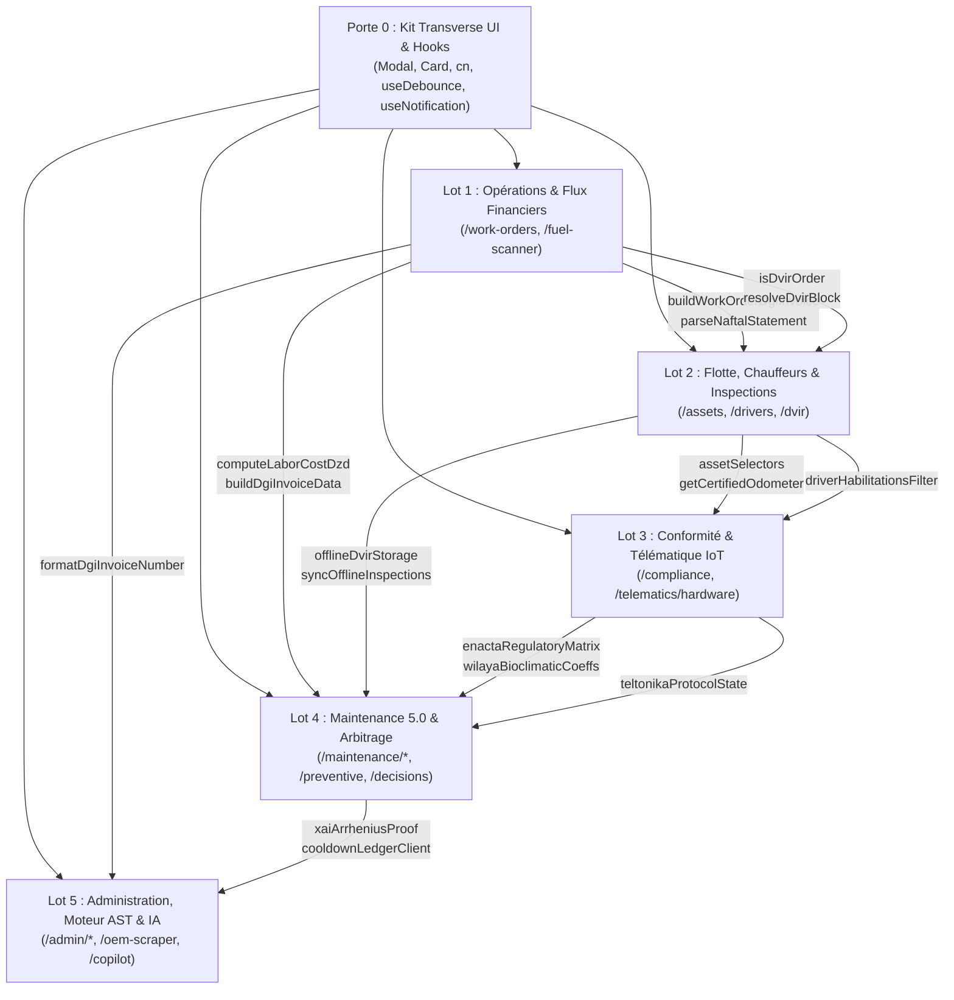

# Graphe de Dépendances & Matrice des Helpers Inter-Lots

> **Document de Référence Technique — Refactorisation Modulaire DocteurFlotte**  
> **Version :** 1.0 (2026-11-14)  
> **Objectif :** Éliminer les régressions silencieuses, les doublons et les refontes contradictoires en cartographiant explicitement les fonctions, helpers et types produits par chaque lot et consommés par les lots ultérieurs.

---

## 🛑 Règle Cardinal d'Ingénierie Inter-Lots

> **Avant d'entamer tout lot $N$ :**  
> L'ingénieur doit vérifier que l'ensemble des modules listés dans **« Dépendances Requises »** existe, est testé et validé.  
> **Si un helper ou composant requis est manquant ou incomplet $\to$ STOP IMMÉDIAT.** Revenir au lot émetteur pour stabiliser l'artefact avant toute modification du lot $N$.

---

## 1. Cartographie des Dépendances par Lot

---

## 2. Matrice Détaillée des Entrées / Sorties

### 📦 Socle Transverse (Porte 0 — Gelé)
- **Produit :**
  - `@/lib/utils/cn` : Fusion conditionnelle de classes Tailwind
  - `@/lib/hooks/useDebounce` : Temporisation paramétrable (défaut 200ms, 400ms OCR)
  - `@/lib/hooks/useDisclosure` : Gestion standardisée des états de modales
  - `@/lib/hooks/useNotification` : Feedback utilisateur auto-dismissé
  - `@/lib/utils/feedbackStyles` : Variantes sémantiques conformes WCAG AA
  - `@/components/ui/Modal` : Modale accessible sur `<dialog>` natif
  - `@/components/ui/Card` : Conteneur Bento standardisé
  - `@/components/ui/ConfirmDialog` : Boîte de dialogue de confirmation d'action critique
  - `@/components/ui/EmptyState` : Affichage d'état vide accessible
  - `@/components/ui/SearchInput` : Entrée de recherche accessible avec touche de raccourci `/`
  - `@/components/ui/NotificationBanner` : Bannière d'alerte avec rôles ARIA
- **Consommé par :** Tous les lots (Lots 1 à 5).

---

### 📦 Lot 1 : Opérations Quotidiennes & Flux Financiers
- **Pages cibles :** `/work-orders` (Terminé), `/fuel-scanner`.
- **Dépendances requises :** Socle Transverse (Porte 0).
- **Helpers et composants produits (réutilisables) :**
  - `@/app/work-orders/lib/buildDgiInvoice.ts` : Générateur de structure de facture fiscale DGI A4 $\to$ **Consommé par Lot 4 et Lot 5**.
  - `@/app/work-orders/hooks/useWorkOrderFilters.ts` : Modèle de synchronisation des filtres avec `URLSearchParams` $\to$ **Consommé comme patron par Lots 2, 3, 4**.
  - `@/app/fuel-scanner/lib/cusumFuelAnalyzer.ts` : Algorithme CUSUM anti-siphonnage avec dévers Valhalla $\to$ **Consommé par Lot 4 (maintenance)**.
  - `@/app/fuel-scanner/lib/naftalPriceResolver.ts` : Résolution dynamique des prix Naftal 2026 $\to$ **Consommé par Lot 3 et Lot 4**.

---

### 📦 Lot 2 : Flotte, Chauffeurs & Inspections Terrain
- **Pages cibles :** `/assets`, `/drivers`, `/dvir`.
- **Dépendances requises :** Socle Transverse, Lot 1 (`isDvirOrder`, `buildDgiInvoice`).
- **Helpers et composants produits (réutilisables) :**
  - `@/app/assets/lib/assetSelectors.ts` : Sélecteurs d'organes d'usure et odomètres certifiés $\to$ **Consommé par Lot 3 et Lot 4**.
  - `@/lib/offline-dvir-storage.ts` : Gestionnaire IndexedDB DVIR Offline-First $\to$ **Consommé par Lot 4 (maintenance)**.
  - `@/app/drivers/lib/licenseCategoriesDz.ts` : Validateur des permis et habilitations algériennes (B, C1, C2, E, CACES) $\to$ **Consommé par Lot 3 (compliance)**.

---

### 📦 Lot 3 : Conformité ENACTA & Télématique IoT
- **Pages cibles :** `/compliance`, `/telematics/hardware`.
- **Dépendances requises :** Socle Transverse, Lot 2 (`assetSelectors`, `licenseCategoriesDz`).
- **Helpers et composants produits (réutilisables) :**
  - `@/app/compliance/lib/enactaPeriodicityCalculator.ts` : Calculateur d'échéances ENACTA selon l'âge du véhicule (Décrets 03-223 et 17-255) $\to$ **Consommé par Lot 4**.
  - `@/app/telematics/lib/teltonikaDecoder.ts` : Décodeur et télémétrie CAN/J1939 $\to$ **Consommé par Lot 4 (maintenance/diagnostics)**.

---

### 📦 Lot 4 : Maintenance 5.0 & Arbitrage Financier
- **Pages cibles (Route-Splitting Acté) :**
  - `/maintenance` (Hub synthèse)
  - `/maintenance/diagnostics` (DTC & OBD2)
  - `/maintenance/organs` (Jumeau numérique 6 organes)
  - `/maintenance/calculations` (XAI Arrhenius / SAD $\to$ ADS)
  - `/maintenance/cooldown` (Registre anti-echo storm 72h)
  - `/preventive`
  - `/decisions`
- **Dépendances requises :** Socle Transverse, Lot 1 (facturation DGI, CUSUM), Lot 2 (organes, DVIR lock), Lot 3 (ENACTA, CAN).
- **Helpers et composants produits (réutilisables) :**
  - `@/app/maintenance/lib/arrheniusOilLife.ts` : Cinétique d'usure thermique d'huile selon la Wilaya $\to$ **Consommé par Lot 5**.
  - `@/app/decisions/lib/sadAdsArbitrage.ts` : Moteur d'arbitrage financier DZD (remorquage saharien vs tell) $\to$ **Consommé par Lot 5**.

---

### 📦 Lot 5 : Administration, Moteur AST & IA Observability
- **Pages cibles :** `/admin/decision-engine`, `/admin/subscriptions`, `/oem-scraper`, `/admin/ai-observability`, `/copilot`.
- **Dépendances requises :** Socle Transverse, Lot 1, Lot 2, Lot 3, Lot 4.
- **Helpers et composants produits :**
  - `@/app/admin/decision-engine/lib/astNodeEvaluator.ts` : Évaluateur d'arbres de décision financiers AST.
  - `@/app/copilot/lib/darjaVoiceRouter.ts` : Routeur d'intentions phonétiques Darja / Français.

---

## 3. Protocole de Validation de Conformité d'un Lot

À la fin de chaque lot et avant tout merge vers `main` :
1. **Contrôle d'export :** Vérifier que les nouveaux helpers transverses sont placés dans `@/lib/` ou dans le répertoire `lib/` de la page et exportés proprement.
2. **Contrôle d'absence de doublon :** Aucun nouveau helper ne doit dupliquer une fonction existante listée dans ce document.
3. **Mise à jour du document :** Toute nouvelle fonction partagée doit être inscrite dans ce fichier avec sa signature TypeScript.

