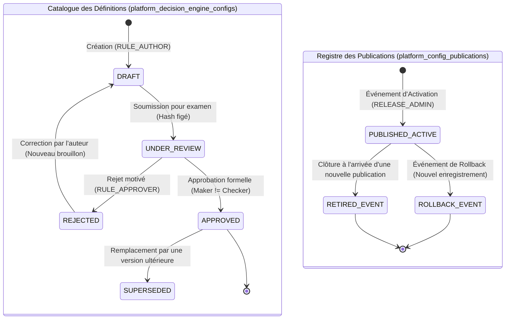

# CONFIGURATION_GOVERNANCE.md — Gouvernance des Règles, Publication & Immutabilité (v2.0)

**Produit :** Plateforme Souveraine DocteurFlotte (Marché Algérien)  
**Niveau :** Document Directeur — Cycle de Vie, Approbations & Registre de Publication Immuable  
**Alignement :** [`MASTER_SPEC.md`](file:///e:/docteurflotte_2027/MASTER_SPEC.md), [`CONTROL_PLANE_ARCHITECTURE.md`](file:///e:/docteurflotte_2027/docs/architecture/CONTROL_PLANE_ARCHITECTURE.md)  
**Date de révision :** 2026-10-26  
**Statut :** ACCEPTÉ & CONTRACTUEL (Révisé Suite à Audit Expert)  

---

## 1. Cycle de Vie Formel & Séparation Définition vs Publication

L'audit expert a révélé une faiblesse de conception majeure : faire transiter une version archivée (`RETIRED`) vers `ACTIVE` lors d'un rollback violait la terminaison des états et brisait l'immutabilité historique.

Pour résoudre définitivement cette incohérence, l'architecture sépare **le catalogue des définitions de version** (immuables dès approbation) du **registre des publications effectives** (journal d'événements append-only) :



### Définition Rigoureuse des États de Version
1. **`DRAFT` (Brouillon) :** Version en cours de travail par un auteur habilité (`RULE_AUTHOR`). Totalement invisible pour le Data Plane.
2. **`UNDER_REVIEW` (En Examen) :** Version figée dont le contenu canonique est haché en SHA-256 (`content_canonical_hash`). Aucune modification n'est permise sans repasser en `DRAFT`.
3. **`APPROVED` (Approuvée) :** Version formellement vérifiée par un réviseur indépendant (`RULE_APPROVER`). Le réviseur scelle expressément l'empreinte `content_canonical_hash`.
4. **`REJECTED` (Rejetée) :** Version refusée avec consigne obligatoire du motif de rejet dans l'audit log.
5. **`SUPERSEDED` (Remplacée / Caducité Légale) :** Ancienne définition archivée, conservée en lecture seule pour la reproductibilité historique des décisions passées.

---

## 2. Protocole Maker-Checker de Bout en Bout

Pour empêcher toute altération unilatérale ou contournement de sécurité :
1. **Authentification & Identité Serveur Garantie :** L'`author_id` est impérativement extrait du jeton de session validé côté serveur (`req.user.id`), interdisant toute manipulation via le payload JSON ou le DTO.
2. **Sceau sur l'Empreinte Canonique :** L'approbation ne porte pas sur un simple identifiant, mais sur l'empreinte SHA-256 canonique du contenu (`content_canonical_hash`). Si le payload en base est altéré après soumission, l'approbation est frappée de nullité immédiate.
3. **Séparation Stricte des Rôles (Dual-Control) :**
   - L'auteur ne peut pas approuver sa propre version.
   - Les permissions RBAC d'approbation (`RULE_APPROVER`) et de publication (`PLATFORM_RELEASE_ADMIN`) sont strictement disjointes.
4. **Garde-fous Base de Données (Contraintes Fail-Closed) :**
   ```sql
   ALTER TABLE platform_decision_engine_configs
   ADD CONSTRAINT chk_maker_checker_distinct
   CHECK (
       (status != 'APPROVED') OR 
       (approved_by_email IS NOT NULL AND approved_by_email <> author_email)
   );
   ```

---

## 3. Activation Transactionnelle par Périmètre (`scope_key`) & Outbox

L'activation d'une configuration n'est jamais globale et indifférenciée : elle est strictement délimitée par son **périmètre d'application** (`scope_key`, ex: `ALGERIA_CORE_DECISION`, `ALGERIA_HAZMAT_RULES`, ou `TENANT_<ID>`).

### Transaction SQL Atomique avec Vérification Stricte
La procédure d'activation garantit qu'exactement une version est active par périmètre, vérifie le statut `APPROVED` et consigne l'événement dans la table Outbox au sein du même bloc transactionnel :

```sql
CREATE OR REPLACE FUNCTION fn_activate_platform_config(
    p_config_id UUID,
    p_actor_email VARCHAR(255),
    p_scope_key VARCHAR(100),
    p_justification TEXT
) RETURNS UUID AS $$
DECLARE
    v_config RECORD;
    v_pub_id UUID;
    v_retired_count INT;
BEGIN
    -- 1. Verrouillage du périmètre via enregistrement de publication
    PERFORM pg_advisory_xact_lock(hashtext(p_scope_key));

    -- 2. Vérification que la configuration cible est formellement APPROVED
    SELECT id, version, content_canonical_hash, status
    INTO v_config
    FROM platform_decision_engine_configs
    WHERE id = p_config_id;

    IF NOT FOUND THEN
        RAISE EXCEPTION 'Configuration non trouvée : %', p_config_id USING ERRCODE = 'P0002';
    END IF;

    IF v_config.status <> 'APPROVED' THEN
        RAISE EXCEPTION 'Action interdite : la configuration % est au statut %, statut APPROVED exigé', 
            v_config.version, v_config.status USING ERRCODE = '22023';
    END IF;

    -- 3. Clôture de la publication active précédente pour ce périmètre
    UPDATE platform_config_publications
    SET effective_to = NOW(),
        updated_at = NOW()
    WHERE scope_key = p_scope_key AND effective_to IS NULL;
    GET DIAGNOSTICS v_retired_count = ROW_COUNT;

    -- 4. Insertion de la nouvelle publication active
    INSERT INTO platform_config_publications (
        scope_key, config_id, version, event_type, effective_from, 
        published_by, canonical_content_hash, justification
    ) VALUES (
        p_scope_key, v_config.id, v_config.version, 'PUBLICATION_ACTIVATE', NOW(),
        p_actor_email, v_config.content_canonical_hash, p_justification
    ) RETURNING id INTO v_pub_id;

    -- 5. Pattern Outbox Transactionnel pour l'invalidation du cache Redis
    INSERT INTO platform_transactional_outbox (
        event_type, aggregate_type, aggregate_id, payload
    ) VALUES (
        'CONFIG_CACHE_INVALIDATED', 'DECISION_CONFIG', v_config.id::TEXT,
        json_build_object(
            'scope_key', p_scope_key,
            'config_id', v_config.id,
            'version', v_config.version,
            'canonical_hash', v_config.content_canonical_hash,
            'published_at', NOW()
        )
    );

    -- 6. Journal d'audit immuable
    INSERT INTO platform_audit_logs (
        actor_email, action, target_entity, target_id, notes
    ) VALUES (
        p_actor_email, 'ACTIVATE_CONFIG', 'platform_config_publications', v_pub_id::TEXT,
        format('Activation de la version %s pour le périmètre %s (Versions antérieures clôturées : %s)',
               v_config.version, p_scope_key, v_retired_count)
    );

    RETURN v_pub_id;
END;
$$ LANGUAGE plpgsql;
```

---

## 4. Protocole de Rollback Append-Only (Sans Altération Historique)

Le retour arrière d'urgence respecte les règles suivantes :
1. **Zéro Réactivation Mutante :** Le rollback **ne modifie jamais** le statut des lignes archivées dans `platform_decision_engine_configs`.
2. **Événement de Publication Distinct :** Il insère une nouvelle ligne dans `platform_config_publications` avec `event_type = 'PUBLICATION_ROLLBACK'`, pointant vers la version approuvée antérieure.
3. **Mesure des Deux Délais de Reprise :**
   - **Délai de Commit Transactionnel :** Validé et commité en base en $< 100\text{ ms}$.
   - **Temps de Convergence Runtime :** Délai entre le commit et l'invalidation effective du cache chez 100 % des workers (cible mesurée $< 500\text{ ms}$). En cas de déconnexion temporaire d'un worker du canal Redis Pub/Sub, le worker rafraîchit son cache en consultant `platform_config_publications` dès reconnexion.

---

## 5. Reproductibilité & Paquet de Preuves Légal

Pour assurer la vérifiabilité d'une décision devant un expert judiciaire, un assureur ou un commissaire aux comptes, l'empreinte SHA-256 seule ne suffit pas. Le système constitue pour chaque arbitrage un **paquet de preuves canonique** (`rule_evidence_package`) contenant :
1. **Entrées Normalisées :** Série temporelle filtrée avec horodatages UTC et scores de confiance $C_{\text{data}}$.
2. **Version & Empreinte de Configuration :** Identifiant `config_id` et `canonical_content_hash` issus du registre des publications.
3. **Empreinte du Code Moteur :** Hash Git du commit exact du moteur décisionnel (`engine_git_commit`).
4. **Conventions Numériques :** Règles d'arrondi explicites, locale et fuseau horaire.
5. **Sorties Décisionnelles Originales :** Arbitrage produit, coûts d'inaction calculés et score VHI.
6. **Conformité Loi 18-07 / Loi 25-11 :** Conservation des données brutes selon les règles de minimisation et de rétention définies au registre national.

