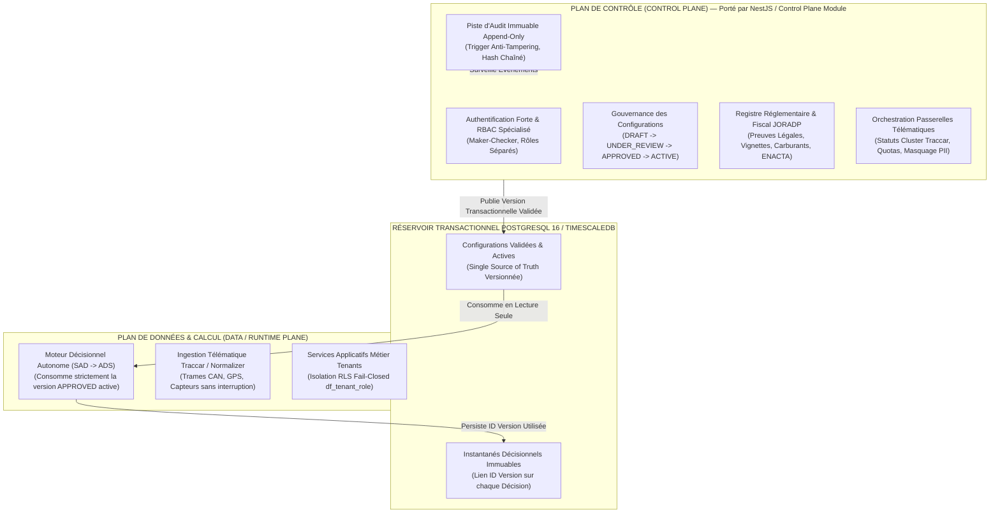

# CONTROL_PLANE_ARCHITECTURE.md — Architecture du Plan de Contrôle Plateforme (v2.0)

**Produit :** Plateforme Souveraine DocteurFlotte (Marché Algérien)  
**Niveau :** Document Directeur d'Architecture — Plan de Contrôle SaaS (SuperAdmin)  
**Alignement :** [`MASTER_SPEC.md`](file:///e:/docteurflotte_2027/MASTER_SPEC.md), [`AGENTS.md`](file:///e:/docteurflotte_2027/AGENTS.md)  
**Date d'approbation :** 2026-10-26  
**Statut :** ACCEPTÉ & CONTRACTUEL  

---

## 1. Séparation Stricte : Plan de Contrôle (Control Plane) vs Plan de Données (Data/Runtime Plane)

L'audit expert a mis en lumière un risque architectural majeur : transformer la console d'administration en chemin d'exécution direct des calculs métiers.
Pour garantir la disponibilité et la non-ingérence, l'architecture sépare hermétiquement les deux plans :



### Invariants Architecturaux
1. **Zéro Impact d'Administration sur le Runtime :** Une modification en cours (brouillon, revue) dans le Control Plane n'altère en aucun cas les décisions en temps réel générées pour les flottes. Le Data Plane lit uniquement les versions publiées actives via le registre des publications (`platform_config_publications`).
2. **Pas de Fallback Silencieux sur Erreur :** Si une configuration active est invalide ou manquante pour un domaine donné, le moteur de calcul n'applique jamais une valeur arbitraire inventée. Il produit explicitement un statut `DECISION_UNAVAILABLE` avec code d'erreur auditable (`ERR_CONFIG_MISSING`).
3. **Traçabilité Bilatérale des Décisions :** Chaque recommandation décisionnelle enregistrée dans `decision_recommendations` contient obligatoirement `config_version_id`, `rule_version_id` et l'empreinte canonique `config_hash`. Une décision rendue il y a 6 mois reste 100 % reproductible et vérifiable.
4. **Pattern Outbox Transactionnel pour l'Invalidation de Cache :** Tout événement d'activation ou de rollback enregistre un message dans une table `platform_transactional_outbox` au sein de la même transaction SQL. Aucune notification Redis n'est émise avant le commit de la transaction, éliminant les faux signaux et les pertes de synchronisation en cas de panne réseau.

---

## 2. Modèle d'Autorisation & Séparation des Privilèges PostgreSQL

L'utilisation d'un rôle monolithique `SUPER_ADMIN` ou l'exécution applicative sous le superuser PostgreSQL (`postgres`) est formellement proscrite. L'architecture instaure une séparation stricte des rôles applicatifs et des rôles de base de données :

### 2.1 Rôles Applicatifs Control Plane (Maker-Checker)

| Rôle Plateforme | Responsabilités Précises | Droits d'Écriture | Restrictions Absolues |
| :--- | :--- | :--- | :--- |
| **`PLATFORM_OPERATOR`** | Supervision opérationnelle, monitoring des conteneurs, santé Traccar, consultation d'audit. | Lecture seule sur toute la plateforme. | Interdiction de modifier les règles, tenants ou barèmes. |
| **`RULE_AUTHOR`** (Maker) | Rédaction de nouvelles versions d'algorithmes, ajustements de seuils, saisie des barèmes fiscaux. | Création et mise à jour de versions en statut `DRAFT` et soumission `UNDER_REVIEW`. | **Interdiction formelle d'approuver ou d'activer** ses propres règles. |
| **`RULE_APPROVER`** (Checker) | Relecture juridique, contrôle des références JORADP, validation scientifique des modèles. | Passage des versions de `UNDER_REVIEW` à `APPROVED` ou `REJECTED`. | Ne peut pas approuver une règle dont il est l'auteur (Dual-Control). |
| **`PLATFORM_RELEASE_ADMIN`** | Activation transactionnelle des versions approuvées et gestion des rollbacks via le registre de publication. | Bascule d'activation transactionnelle par périmètre (`scope_key`). | Ne peut activer que des versions ayant reçu le sceau `APPROVED`. |
| **`PLATFORM_SECURITY_ADMIN`** | Gestion des clés de chiffrement, révocation des sessions, revue des alertes anti-tampering. | Gestion des accès et secrets d'infrastructure. | Ne modifie pas les règles métier ou décisionnelles. |

### 2.2 Rôles PostgreSQL Dédiés au Niveau Base de Données

Pour empêcher toute élévation de privilèges ou contournement applicatif, la base PostgreSQL applique des rôles distincts avec le principe de moindre privilège :

| Rôle PostgreSQL | Périmètre des Droits | Restrictions Fondamentales |
| :--- | :--- | :--- |
| **`df_gov_writer`** | `SELECT`, `INSERT`, `UPDATE` sur `platform_decision_engine_configs` (statuts DRAFT/UNDER_REVIEW/APPROVED), `platform_config_publications`, tables fiscales et réglementaires. `INSERT` sur `platform_transactional_outbox`. | Aucun droit sur les tables télématiques ni les données sensibles des tenants. |
| **`df_runtime_reader`** | `SELECT` uniquement sur `platform_config_publications` (publications actives) et `platform_decision_engine_configs`. | **Zéro droit d'écriture (`INSERT`, `UPDATE`, `DELETE`)** sur les configurations ou publications. |
| **`df_telematics_ingest`** | `INSERT` sur `telemetry_raw_positions`, `telemetry_can_bus_frames`. | Zéro droit de lecture/écriture sur les configurations de gouvernance ou les tables fiscales. |
| **`df_tenant_app`** | Rôle utilisé par les services métier, soumis à PostgreSQL Row-Level Security (`RLS Fail-Closed`). | Borné strictement par `app.current_tenant_id`. `SELECT` en lecture seule sur les tables de référence nationales. |
| **`df_audit_writer`** | `INSERT` uniquement sur `platform_audit_logs`. | **Zéro droit de modification (`UPDATE`), suppression (`DELETE`) ou vidage (`TRUNCATE`)**, garanti par triggers et révocation de privilèges. |
| **`df_migrator`** | Rôle DDL utilisé exclusivement lors des migrations contrôlées de schéma. | Interdit d'utilisation par les runtimes d'application en production. |

### Procédure d'Urgence "Break-Glass" (Accès Critique Exceptionnel)
- Utilisé uniquement lors d'un incident de production majeur (ex: blocage intempestif de flottes nationales).
- Exige la saisie obligatoire d'un ticket d'incident certifié, d'une justification textuelle et de l'approbation de deux officiers distincts.
- Session limitée à 60 minutes avec niveau de journalisation d'audit maximal (capture complète des requêtes et états avant/après).

---

## 3. Frontières de Confiance & Flux Réseau Sécurisés

```mermaid
flowchart LR
    subgraph InternetZone["Zone Externe Publique"]
        ADMIN_USER["Navigateur Administrateur Habilité"]
        TRACCAR_DEVICES["Boîtiers GPS / CAN Télématique"]
    end

    subgraph DMZ["DMZ / Reverse Proxy Local"]
        CADDY["Caddy Reverse Proxy (TLS 1.3 / HSTS / Rate Limit)"]
    end

    subgraph InternalServices["Réseau Interne Local Dokku / Docker"]
        NEXT_ADMIN["Next.js 15 Web Console (/admin)"]
        NEST_API["NestJS Backend API (/api/admin)"]
        TRACCAR_CORE["Traccar 6.x Self-Hosted (Port 8085)"]
        PG_TIMESCALEDB["PostgreSQL 16 / TimescaleDB (Port 5434)"]
        OUTBOX_WORKER["Worker Outbox Invalidation Cache"]
        REDIS_CACHE["Redis 7 Cluster Cache (Port 6380)"]
    end

    ADMIN_USER -->|HTTPS / WSS (MFA Requis)| CADDY
    TRACCAR_DEVICES -->|Ports Protocoles 5001-5093| CADDY
    CADDY --> NEXT_ADMIN
    CADDY --> TRACCAR_CORE
    NEXT_ADMIN -->|Appels Serveur Authentifiés DTO| NEST_API
    NEST_API -->|Connexion df_gov_writer| PG_TIMESCALEDB
    PG_TIMESCALEDB -->|Polling / CDC Outbox| OUTBOX_WORKER
    OUTBOX_WORKER -->|Pub/Sub Invalidation| REDIS_CACHE
```

### Règles de Flux & Validation
1. **Validation Stricte des Entrées (Zod & class-validator) :** Aucun objet JSON brut n'est injecté en base. Chaque requête d'administration traverse un DTO typé avec validation des bornes physiques, des formats de date et des références officielles.
2. **Élimination des Routes Proxy Superflues :** Les routes d'administration `/api/admin/*` s'exécutent de façon unifiée côté backend avec vérification de jeton cryptographique, éliminant les duplications de règles d'authentification entre Next.js et NestJS.
3. **Protection de la Télématique Extérieure (Loi 18-07 / Loi 25-11) :** En cas d'activation de la passerelle de secours Flespi, le service `telematics-proxy` filtre rigoureusement toute donnée nominative : seul l'IMEI technique du boîtier et les coordonnées GPS brutes sont transmis, sans immatriculation, nom de chauffeur ou identifiant client.

---

## 4. Contrats d'API du Plan de Contrôle (REST Endpoints)

| Méthode & Endpoint | Rôle Requis | Description & Effet | Validation & Code d'Erreur |
| :--- | :--- | :--- | :--- |
| `GET /api/admin/tenants` | `PLATFORM_OPERATOR`+ | Liste paginée des organisations, statuts, plans et métriques d'usage. | 200 OK |
| `POST /api/admin/tenants` | `PLATFORM_RELEASE_ADMIN` | Création d'un tenant avec quotas contractuels explicites. | DTO strict, 400 Bad Request si quota < 0 |
| `PUT /api/admin/tenants/:id/status` | `PLATFORM_RELEASE_ADMIN` | Suspension, réactivation ou clôture avec motif obligatoire. | 200 OK, Audit Log généré |
| `GET /api/admin/decision-engine/configs` | `PLATFORM_OPERATOR`+ | Liste des versions de configuration du moteur (tous statuts). | 200 OK |
| `POST /api/admin/decision-engine/configs` | `RULE_AUTHOR` | Création d'une nouvelle version de calcul en statut `DRAFT` avec calcul du hash canonique. | Vérification bornes physiques, 201 Created |
| `POST /api/admin/decision-engine/configs/:id/approve` | `RULE_APPROVER` | Approbation d'une version soumise sur son hash exact (Maker != Checker). | 403 Forbidden si Approver == Author ou hash modifié |
| `POST /api/admin/decision-engine/configs/:id/activate` | `PLATFORM_RELEASE_ADMIN` | Publication transactionnelle délimitée par `scope_key` vers `platform_config_publications`. | 200 OK, insertion Outbox d'invalidation |
| `POST /api/admin/decision-engine/publications/rollback` | `PLATFORM_RELEASE_ADMIN` | Publication d'un événement de rollback vers la version approuvée précédente. | 200 OK, Audit Log généré, insertion Outbox |
| `GET /api/admin/fiscal/fuel-prices` | `PLATFORM_OPERATOR`+ | Historique complet des barèmes carburant Naftal et dates d'effet (2020-2025 et 2026). | 200 OK |
| `POST /api/admin/fiscal/fuel-prices` | `RULE_AUTHOR` | Saisie d'un nouveau tarif avec référence JORADP / source officielle obligatoire. | 400 Bad Request si Réf officielle manquante |
| `GET /api/admin/audit-logs` | `PLATFORM_SECURITY_ADMIN` | Consultation du registre d'audit immuable avec vérification de chaîne. | 200 OK, indicateur `chain_integrity_valid` |

---

## 5. Résilience & Continuité d'Activité (SLO / SLA)

Les indicateurs de service suivants constituent les cibles opérationnelles soumises à épreuve sous conditions de charge calibrées :
- **RTO (Recovery Time Objective) :** Cible $< 15\text{ minutes}$ pour la restauration intégrale de la base de données PostgreSQL à partir d'un dump certifié.
- **RPO (Recovery Point Objective) :** Cible $< 5\text{ minutes}$ via l'archivage continu des Write-Ahead Logs (WAL) PostgreSQL et snapshots quotidiens chiffrés.
- **Latence Maximale du Moteur Décisionnel :** Cible $< 150\text{ ms}$ au 99e centile (P99) mesurée sur une charge représentative de 5 000 requêtes concurrentes d'arbitrage économique avec données en cache chaud.
- **Temps de Convergence Runtime (Rollback) :** Cible $< 500\text{ ms}$ entre le commit de la transaction de publication de rollback et la prise en compte effective par 100 % des workers du Data Plane.

