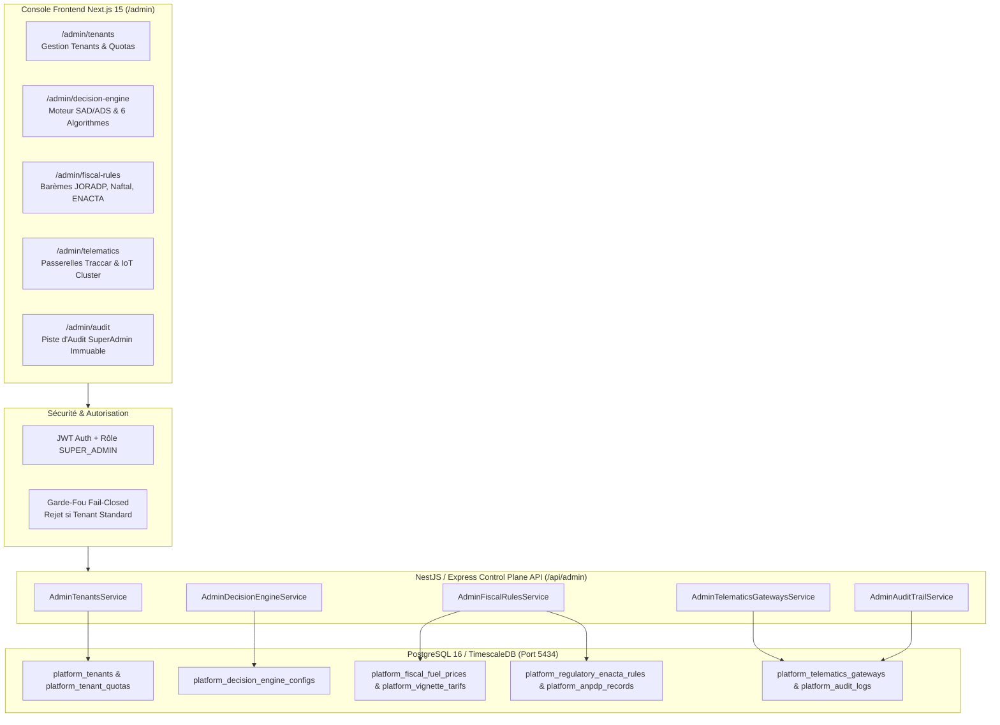

# Plan Directeur d'Implémentation : Console d'Administration SaaS DocteurFlotte (SuperAdmin & Control Plane)

> **Référence Contractuelle :** [`MASTER_SPEC.md`](file:///e:/docteurflotte_2027/MASTER_SPEC.md) (v2.0) & [`AGENTS.md`](file:///e:/docteurflotte_2027/AGENTS.md) (v2.0)  
> **Principe Cardinal :** **ZÉRO VARIABLE CODÉE EN DUR.** Tous les paramètres, barèmes, prix, taux, seuils et matrices sont externalisés dans des tables relationnelles versionnées et administrables via l'interface.

---

## 1. Vision & Objectifs Métier

La Console d'Administration SaaS (**DocteurFlotte Control Plane**) est l'organe central de gouvernance, d'exploitation et de supervision de la plateforme souveraine pour le marché algérien. Elle permet aux super-administrateurs de piloter l'intégralité des briques vitales sans aucune modification de code :
1. **Multi-Tenant SaaS Control Plane :** Cycle de vie des tenants (onboarding, quotas, plans d'adoption Mode 0 / Mode 1 / Mode 2, étanchéité RLS, suspension).
2. **Gouvernance du Moteur Décisionnel Principal (SAD $\rightarrow$ ADS) :** Réglage fin des 6 algorithmes physiques déterministes, seuils de criticité, pondérations VHI, matrice de sévérité climatique algérienne et arbitrages coût d'action vs risque d'inaction.
3. **Moteur Fiscal & Réglementaire Algérien :** Barèmes officiels ENACTA, vignettes automobiles (Loi de Finances), tarifs carburant Naftal versionnés (JORADP), déductibilité fiscale et conformité stricte à la Loi 18-07 (ANPDP).
4. **Passerelles Télématiques & IoT :** Pilotage du cluster Traccar self-hosted, quotas de trames, bascule de secours failover sans transmission de PII.
5. **Journal d'Audit & Observabilité Système :** Traçabilité immuable de chaque modification avec référence légale JORADP obligatoire pour les règles nationales.

---

## 2. Architecture Technique & Étanchéité de Sécurité

---

## 3. Modélisation de Données "Zéro Constante en Dur" (DDL PostgreSQL)

### 3.1 Gestion des Tenants & Quotas
- `platform_tenants` :
  - `id` UUID PRIMARY KEY, `name` VARCHAR, `slug` VARCHAR UNIQUE, `activity_pack` VARCHAR, `plan_tier` VARCHAR (`STARTER_MODE_0`, `PRO_GPS_MODE_1`, `ENTERPRISE_IOT_MODE_2`).
  - `status` VARCHAR (`ACTIVE`, `TRIAL`, `SUSPENDED`, `TERMINATED`).
  - `max_vehicles` INT, `max_devices` INT, `max_users` INT, `max_api_rate_per_min` INT.
  - `contact_email` VARCHAR, `contact_phone` VARCHAR, `nif` VARCHAR, `nis` VARCHAR, `created_at`, `updated_at`.
- `platform_tenant_quotas_usage` : Compteurs actuels (véhicules actifs, boîtiers en ligne, stockage mégaoctets, appels API 24h).

### 3.2 Paramétrage du Moteur Décisionnel (SAD / ADS)
- `platform_decision_engine_configs` :
  - `id` UUID PRIMARY KEY, `version` VARCHAR NOT NULL, `is_active` BOOLEAN DEFAULT TRUE.
  - `arrhenius_activation_energy` NUMERIC DEFAULT 6500.0, `arrhenius_ref_temp_c` NUMERIC DEFAULT 90.0.
  - `battery_crit_voltage_mv_12v` NUMERIC DEFAULT 9600.0, `battery_crit_voltage_mv_24v` NUMERIC DEFAULT 19200.0.
  - `battery_temp_compensation_factor` NUMERIC DEFAULT 15.0.
  - `cooling_ewma_alpha` NUMERIC DEFAULT 0.15, `cooling_overheat_threshold_c` NUMERIC DEFAULT 11.0.
  - `brake_wear_energy_per_mm_mj` NUMERIC DEFAULT 25.0, `brake_min_thickness_mm` NUMERIC DEFAULT 3.0.
  - `fuel_siphon_stop_liters` NUMERIC DEFAULT 15.0, `fuel_cusum_slack_liters` NUMERIC DEFAULT 0.6, `fuel_cusum_alarm_ratio` NUMERIC DEFAULT 0.05.
  - `vhi_weights` JSONB NOT NULL DEFAULT '{"engine": 0.35, "brakes": 0.25, "cooling": 0.20, "battery": 0.10, "transmission": 0.10}'::jsonb.
  - `inaction_risk_multiplier` NUMERIC DEFAULT 3.5.
  - `downtime_daily_costs_dzd` JSONB NOT NULL DEFAULT '{"HEAVY_TRUCK": 45000, "LCV": 15000, "CONSTRUCTION": 65000, "BUS": 35000, "AGRI_TRACTOR": 25000}'::jsonb.
  - `climate_severity_factors` JSONB NOT NULL DEFAULT '{"TELL_URBAN": 0.80, "HIGH_PLATEAUS": 0.70, "SAHARA_DESERT": 0.55}'::jsonb.
  - `created_at`, `updated_at`, `updated_by` VARCHAR.

### 3.3 Moteur Fiscal & Réglementaire Algérien
- `platform_fiscal_fuel_prices` :
  - `id` UUID PRIMARY KEY, `fuel_type` VARCHAR (`DIESEL_GASOIL`, `ESSENCE_SANS_PLOMB`, `ESSENCE_SUPER`, `GPL_SIRGHAZ`).
  - `price_per_liter_dzd` NUMERIC(6, 2) NOT NULL.
  - `tva_rate_pct` NUMERIC(4, 2) NOT NULL DEFAULT 19.00.
  - `is_tva_deductible` BOOLEAN NOT NULL DEFAULT TRUE.
  - `official_reference_joradp` VARCHAR NOT NULL.
  - `effective_date` DATE NOT NULL.
  - `is_active` BOOLEAN NOT NULL DEFAULT TRUE.
- `platform_vignette_tarifs` :
  - `id` UUID PRIMARY KEY, `vehicle_category` VARCHAR, `power_cv_min` INT, `power_cv_max` INT, `vehicle_age_min_years` INT, `vehicle_age_max_years` INT.
  - `amount_dzd` NUMERIC(10, 2) NOT NULL.
  - `finance_law_year` INT NOT NULL, `official_reference_joradp` VARCHAR NOT NULL.
- `platform_regulatory_enacta_rules` :
  - `id` UUID PRIMARY KEY, `asset_category` VARCHAR, `periodicity_months` INT NOT NULL, `grace_period_days` INT DEFAULT 0.
  - `warning_lead_days` INT[] DEFAULT ARRAY[30, 15, 7], `mandatory_checkpoints` TEXT[], `official_decree_ref` VARCHAR NOT NULL.
- `platform_anpdp_records` :
  - Registre de traitement Loi 18-07, DPO officiel désigné, déclaration ANPDP, date d'approbation et journal de conformité.

### 3.4 Passerelles Télématiques & Audit Trail
- `platform_telematics_gateways` :
  - `id` UUID PRIMARY KEY, `name` VARCHAR, `provider_type` VARCHAR (`TRACCAR_SELF_HOSTED`, `FLESPI_FAILOVER`), `endpoint_url` VARCHAR, `health_status` VARCHAR, `ports_list` VARCHAR, `max_packets_per_sec` INT, `last_heartbeat_at` TIMESTAMPTZ.
- `platform_audit_logs` :
  - `id` UUID PRIMARY KEY, `actor_email` VARCHAR NOT NULL, `ip_address` VARCHAR, `action` VARCHAR NOT NULL, `target_entity` VARCHAR NOT NULL, `target_id` VARCHAR, `before_state` JSONB, `after_state` JSONB, `legal_reference` VARCHAR, `created_at` TIMESTAMPTZ DEFAULT NOW().

---

## 4. Découpage en Tâches d'Exécution (TDD & DoD)

### Tâche 1 : Migrations SQL & Données de Référence Initiales
- **Fichier :** `database/migrations/03_saas_platform_admin.sql`
- **Contenu :** Création des 8 tables de la plateforme SuperAdmin avec contraintes, index et politiques d'accès administrateur.
- **Vérification :** Exécution du script SQL dans le conteneur PostgreSQL `docteurflotte_postgres`.

### Tâche 2 : Services & Contrôleurs Backend (NestJS / API)
- **Fichiers :**
  - `apps/api/src/admin/admin.module.ts`
  - `apps/api/src/admin/services/admin-tenants.service.ts`
  - `apps/api/src/admin/services/admin-decision-engine.service.ts`
  - `apps/api/src/admin/services/admin-fiscal.service.ts`
  - `apps/api/src/admin/services/admin-gateways.service.ts`
  - `apps/api/src/admin/admin.controller.ts`
- **Tests :** `apps/api/src/admin/admin.service.spec.ts` (vérification de la validation stricte, rejet des valeurs non autorisées et traçabilité d'audit).

### Tâche 3 : Routes Web API Next.js & Client SDK
- **Fichiers :**
  - `apps/web/src/app/api/admin/tenants/route.ts`
  - `apps/web/src/app/api/admin/decision-engine/route.ts`
  - `apps/web/src/app/api/admin/fiscal/route.ts`
  - `apps/web/src/app/api/admin/gateways/route.ts`
  - `apps/web/src/lib/api-platform-admin.ts`

### Tâche 4 : Interface Utilisateur Haute Fidélité (/admin)
- **Fichiers :**
  - `apps/web/src/app/admin/page.tsx` : Dashboard SuperAdmin avec KPIs globaux et raccourcis.
  - `apps/web/src/app/admin/tenants/page.tsx` : Gestion des tenants, statuts, quotas et bascule de mode.
  - `apps/web/src/app/admin/decision-engine/page.tsx` : Console de configuration des 6 algorithmes physiques, VHI et simulateur d'arbitrage.
  - `apps/web/src/app/admin/fiscal-rules/page.tsx` : Gestionnaire des tarifs Naftal, barème ENACTA et vignettes avec référence JORADP.
  - `apps/web/src/app/admin/telematics/page.tsx` : Monitoring Traccar, ports, latence et bascule Flespi.
  - `apps/web/src/components/navigation/NavFeaturesMenu.tsx` : Ajout du lien vers la Console d'Administration pour les profils habilités.

### Tâche 5 : Validation Guardrails, Typescript & Tests E2E
- Exécution de `pnpm verify` (Zéro secret, RLS Fail-Closed, Typecheck, 52 Jest tests + tests Admin).
- Production du rapport final selon `AGENTS.md § 8`.
