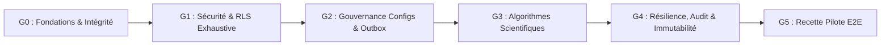

# ACCEPTANCE_GATES.md — Portes de Validation de Recette (G0 à G5)

**Produit :** Plateforme Souveraine DocteurFlotte (Marché Algérien)  
**Niveau :** Protocole de Recette & Validation des Portes Qualité (DoD)  
**Alignement :** [`MASTER_SPEC.md`](file:///e:/docteurflotte_2027/MASTER_SPEC.md), [`AGENTS.md`](file:///e:/docteurflotte_2027/AGENTS.md) (Section 7)  
**Date de révision :** 2026-10-26  
**Statut :** ACCEPTÉ & CONTRACTUEL (Révisé Suite à Audit Expert)  

---

## 1. Vue d'Ensemble des Portes de Validation

Une tranche n'est déclarée `PASS` que si elle franchit successivement chacune des portes d'acceptation suivantes avec preuve de résultat :



---

## 2. Définition Détaillée des Portes

### Porte G0 : Fondations & Intégrité du Dépôt
- **Objectif :** Vérifier l'absence de régression, la propreté de l'arbre git, la présence des runtimes et l'absence totale de secrets exposés.
- **Commandes d'Épreuve :**
  ```powershell
  . .\scripts\load-env.ps1
  git status --porcelain
  node scripts/guardrails/check-secrets.cjs
  ```
- **Critère de Blocage (NO-GO) :** Tout secret, jeton Traccar, clé API ou mot de passe détecté dans le code entraîne le rejet immédiat sans discussion.

---

### Porte G1 : Sécurité, Étanchéité RLS Exhaustive & Rôles PostgreSQL
- **Objectif :** Démontrer l'étanchéité multi-tenant complète sur toutes les opérations et vérifier que le rôle non-superuser `df_tenant_app` ne peut accéder à aucune donnée hors de son tenant.
- **Scénarios d'Épreuve Réels (Sous rôle `df_tenant_app`, jamais superuser) :**
  1. *Isolation SELECT :* Requêtes directes, jointures et sous-requêtes filtrées à 100 % sur `app.current_tenant_id`.
  2. *Isolation INSERT / UPDATE / DELETE :* Rejet ou limitation stricte à la partition du tenant, tentative d'injection d'un autre `tenant_id` bloquée par la politique RLS.
  3. *Tentative d'Usurpation de Contexte :* Rejet de l'écrasement arbitraire de `app.current_tenant_id` sans ré-authentification serveur.
  4. *Moindre Privilège :* Vérification que `df_tenant_app` n'a aucun droit d'écriture sur les tables de configuration globale ou de publication.

---

### Porte G2 : Gouvernance des Configurations, Scopes & Outbox Transactionnelle
- **Objectif :** Démontrer l'inviolabilité du cycle Maker-Checker, la gestion par périmètre (`scope_key`) et la convergence du runtime via l'Outbox.
- **Scénarios Testés :**
  1. *Maker-Checker :* Un `RULE_AUTHOR` tente d'approuver sa propre version $\rightarrow$ **Erreur 403 Forbidden** au niveau API et violation de contrainte CHECK en base.
  2. *Contrôle d'Empreinte Canonique :* Tentative d'approbation d'une version dont le payload a été altéré après soumission $\rightarrow$ **Rejet pour discordance d'empreinte SHA-256**.
  3. *Activation par Périmètre :* Bascule d'une version pour `ALGERIA_CORE_DECISION` n'affectant aucune autre règle (`ROW_COUNT = 1` vérifié).
  4. *Rollback Append-Only :* Déclenchement d'un rollback publiant un événement sans altérer le statut des lignes archivées.
  5. *Convergence Runtime :* Commit de la publication en $< 100\text{ ms}$, dépilage Outbox et convergence des caches de calcul en $< 500\text{ ms}$.

---

### Porte G3 : Validation Scientifique des Algorithmes Déterministes
- **Objectif :** Exécuter les 6 algorithmes sur leurs équations exactes et valider les cas de référence mathématiquement corrigés.
- **Scénarios Testés :**
  1. *Arrhenius Huile Moteur :*
     Pour $E_a / R = 6\,500\text{ K}$, $T_{\text{ref}} = 90^\circ\text{C}$ et $T_{\text{oil}} = 110^\circ\text{C}$ pendant 100 km réels continus :
     $$k(110^\circ\text{C}) \approx 2.545 \implies \text{Usure équivalente calculée} = \mathbf{254.5 \pm 2.0\text{ km}}$$ (et non 185 km).
  2. *Indicateur Démarrage Batterie (CVHI) :*
     Test 24V à $45^\circ\text{C}$ avec $V_{\text{min}} = 18\,600\text{ mV}$ $\rightarrow$ $V_{\text{corrected}} = 18\,000\text{ mV} \implies \text{CVHI} = 0\%$.
     Test historique : si nombre de démarrages $< 15$, `days_to_failure` retourne strictement `null` (`PREDICTION_UNAVAILABLE`).
  3. *Thermique Résiduel :*
     Vérification de l'injection dynamique de $T_{\text{thermostat}}$ propre à la motorisation. Déclenchement `CRITICAL_OVERHEAT_RISK` uniquement au franchissement du seuil OEM ou EWMA $\ge +11^\circ\text{C}$.
  4. *Freins Archard :*
     Validation de la conversion d'unités ($v / 3.6$) et de la prise en compte du dénivelé gravitationnel $\Delta E_{\text{pot}} = M \cdot g \cdot \Delta h$ en descente montagneuse.
  5. *FAP / DPF :*
     Vérification du protocole à 3 paliers. Absence formelle de commande de régénération forcée automatique sans validation humaine des préconditions.
  6. *Carburant CUSUM :*
     Validation de l'équation signée $e_t = -\Delta V_{\text{tank}} - C_{\text{ECU}}$. Qualification prudente de l'alerte en `SUSPECTED_FUEL_LOSS`.

---

### Porte G4 : Résilience Opérationnelle, Outbox & Piste d'Audit Immuable
- **Objectif :** Démontrer l'inviolabilité de la piste d'audit et la fiabilité du pattern outbox transactionnel.
- **Scénarios Testés :**
  1. *Interdiction UPDATE / DELETE sur Audit :* Tentative d'altération SQL rejetée avec code d'erreur `55000` par le trigger anti-tampering, même sous rôle privilégié applicatif.
  2. *Vérification Chaîne de Hachage :* Détection immédiate de toute rupture dans la chaîne `prev_hash` $\rightarrow$ `entry_hash`.
  3. *Reprise sur Panne Outbox :* Simulation de rupture de connexion Redis : les événements restent stockés dans `platform_transactional_outbox` et sont rejoués sans perte dès reconnexion.
  4. *Télématique Souveraine (Loi 18-07 / Loi 25-11) :* Test d'export vers passerelle tierce : vérification de l'absence totale de PII (seul l'IMEI matériel et les coordonnées brutes sont transmis).

---

### Porte G5 : Recette de Bout en Bout & Parcours Pilote (E2E Journey)
- **Scénario Complet :**
  1. L'auteur crée une version 2.1 révisant les paramètres thermiques pour les camions circulant dans le Sahara.
  2. Soumission pour revue avec calcul de l'empreinte canonique SHA-256.
  3. Approbation par un réviseur indépendant distinct (`RULE_APPROVER`), scellant l'empreinte.
  4. Publication transactionnelle délimitée par `scope_key = 'ALGERIA_CORE_DECISION'`, clôturant la publication précédente et émettant l'événement Outbox.
  5. Évaluation décisionnelle d'un véhicule pilote et validation que le résultat consigne l'identifiant immuable de publication et son empreinte canonique.

